# Zero Trust Architecture and Identity Security
### Integrating IEEE 802.1X, Dynamic VLANs, NAC, and Continuous Access Control

> **An architecture and implementation reference covering identity, network admission, segmentation, and risk-adaptive access control**


*Technical Architecture and Implementation Guide · Dong Xu · November 2026*

---

## Table of Contents

- [Executive Summary](#executive-summary)
- [1. Understanding Zero Trust Architecture](#1-understanding-zero-trust-architecture)
- [2. Identity Security: The Foundation of Zero Trust](#2-identity-security-the-foundation-of-zero-trust)
- [3. IEEE 802.1X and Network Admission Control](#3-ieee-8021x-and-network-admission-control)
- [4. Dynamic VLAN Assignment](#4-dynamic-vlan-assignment-from-static-segmentation-to-identity-aware-network-access)
- [5. Integrating NAC with Zero Trust Policy Decisions](#5-integrating-nac-with-zero-trust-policy-decisions)
- [6. Enterprise Deployment Scenarios](#6-enterprise-deployment-scenarios)
- [7. Microsegmentation and East-West Traffic Protection](#7-microsegmentation-and-east-west-traffic-protection)
- [8. Practical Implementation: A Phased Deployment](#8-practical-implementation-a-phased-deployment)
- [9. Example Implementation: RADIUS and Dynamic VLAN Authorization](#9-example-implementation-radius-and-dynamic-vlan-authorization)
- [10. Security Monitoring, Incident Response, and Policy Automation](#10-security-monitoring-incident-response-and-policy-automation)
- [11. Reliability, Security, and Operational Considerations](#11-reliability-security-and-operational-considerations)
- [12. Measuring Zero Trust Deployment Success](#12-measuring-zero-trust-deployment-success)
- [13. Common Implementation Mistakes](#13-common-implementation-mistakes)
- [14. Future Direction](#14-future-direction-identity-aware-and-risk-adaptive-network-security)
- [15. Conclusion](#15-conclusion)
- [References and Further Reading](#references-and-further-reading)

---

## Executive Summary

**Scope and intended audience:** This guide targets security architects, network engineers, SOC/IR teams, and practitioners designing identity-aware access controls across enterprise campus, remote-access, and hybrid environments. It is an architecture reference with illustrative examples—not a validated, vendor-neutral configuration baseline or a claim of production deployment.

Zero Trust Architecture (ZTA) changes how enterprises decide who gets access. Instead of trusting devices and users because of where they sit on the network, it keeps evaluating access based on identity, device posture, how sensitive the resource is, and contextual risk.

IEEE 802.1X is still an important part of enterprise network security. However, traditional Network Access Control (NAC), even with dynamic VLAN assignment, cannot deliver Zero Trust on its own.

A modern architecture combines five complementary capabilities:

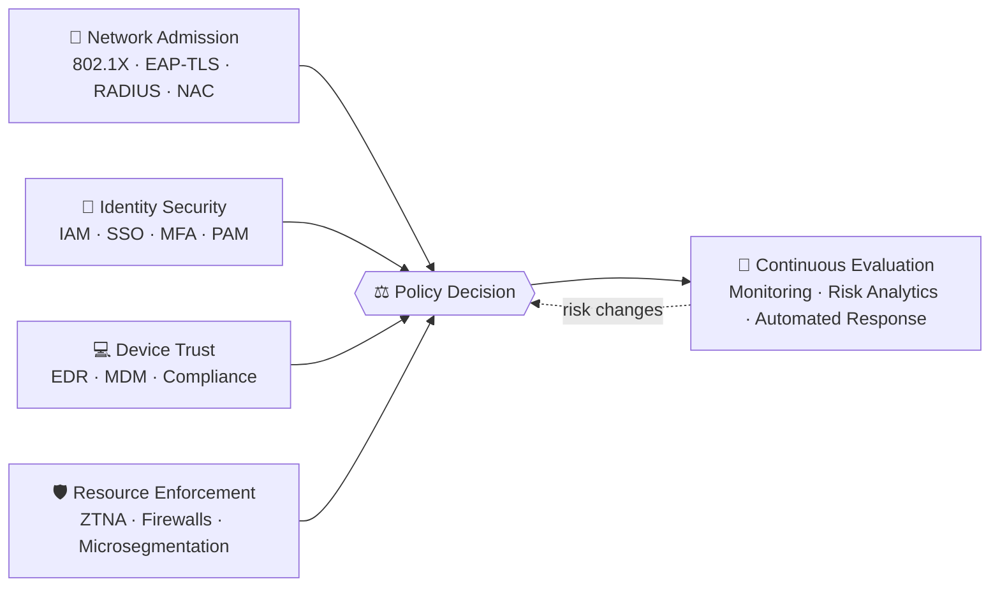

| # | Capability | What it answers | Key technologies |
|---|---|---|---|
| 1 | **Network Admission Control** | May this device join the network? | IEEE 802.1X, EAP-TLS, RADIUS, NAC |
| 2 | **Identity Security** | Who or what is this, and what may it do? | IAM, SSO, MFA, PAM |
| 3 | **Device Trust** | Is the device healthy and managed? | EDR, MDM/UEM, compliance policy |
| 4 | **Resource-Level Enforcement** | Which specific resources may it reach? | ZTNA, firewalls, microsegmentation, app authorization |
| 5 | **Continuous Evaluation** | Should access continue right now? | SIEM/SOAR, risk analytics, RADIUS CoA |

> **Key message:** The goal is not to replace 802.1X with Zero Trust. It is to fold network authentication into a broader, identity-centric security architecture.

---

## 1. Understanding Zero Trust Architecture

### 1.1 From Network Trust to Resource Trust

Traditional enterprise networks often follow a perimeter-based security model:

- Internal networks are treated as relatively trusted.
- External networks are treated as untrusted.
- Users on corporate Wi-Fi or VPN receive broad network-level access.
- Permissions are often based on IP addresses, VLANs, and static firewall rules.

This model breaks down once an enterprise adds hybrid work, cloud applications, IoT devices, third-party access, and distributed workloads. A compromised device on the internal network can abuse that implicit trust to move laterally.

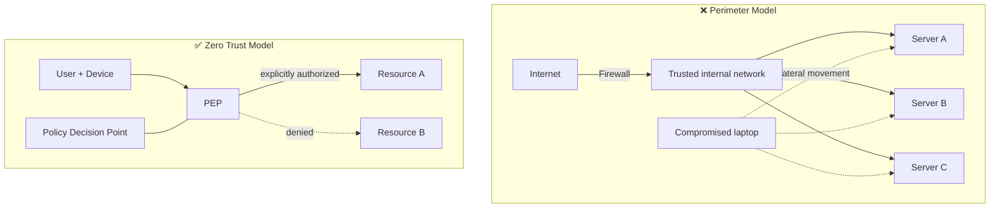

Zero Trust removes the assumption that network location establishes trust. According to NIST SP 800-207, access is granted per resource, per session, with authentication and authorization performed before a connection is established.

**Foundational principles**

- Never grant implicit trust based solely on network location.
- Verify user and device identity.
- Enforce least-privilege access.
- Evaluate contextual risk.
- Continuously monitor security-relevant changes.
- Reassess or revoke access when conditions change.

Zero Trust does not assume every user or device is malicious. It means access must be explicitly authorized and stays conditional.

### 1.2 The NIST Zero Trust Logical Architecture

NIST SP 800-207 defines three core logical components. Together, the Policy Engine and Policy Administrator form the **Policy Decision Point (PDP)**.

| Component | Role |
|---|---|
| **Policy Engine (PE)** | Makes the access decision using identity, device posture, resource classification, policy, and threat intelligence. |
| **Policy Administrator (PA)** | Executes the decision: establishes, modifies, or tears down the communication path, and instructs the PEP. |
| **Policy Enforcement Point (PEP)** | Enables, monitors, and terminates connections between the subject and the resource. |

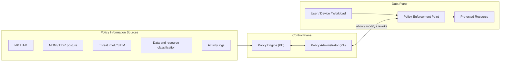

Examples of PEPs include ZTNA gateways, application proxies, firewalls, endpoint agents, API gateways, and **network access devices: switches and wireless controllers enforcing 802.1X**.

> No single PEP is sufficient for every type of enterprise resource.

### 1.3 Mapping to the CISA Zero Trust Maturity Model

The CISA Zero Trust Maturity Model v2.0 organizes Zero Trust into five pillars plus cross-cutting capabilities. This guide's technologies map onto them like this:

| CISA Pillar | Where it appears in this guide |
|---|---|
| **Identity** | IAM, SSO, phishing-resistant MFA, PAM (§2) |
| **Devices** | EAP-TLS device certificates, MDM, EDR posture (§3, §5) |
| **Networks** | 802.1X, dynamic VLANs, ACLs, microsegmentation (§4, §7) |
| **Applications & Workloads** | ZTNA, workload identity, mTLS, SPIFFE (§6) |
| **Data** | Resource sensitivity in policy decisions (§5.2) |
| *Cross-cutting* | Visibility & analytics, automation & orchestration, governance (§10–§12) |

---

## 2. Identity Security: The Foundation of Zero Trust

### 2.1 Identity and Access Management

Identity security establishes **who or what** is requesting access. Enterprise identities include human users, administrators, service accounts, applications, API clients, devices, and cloud workloads.

A mature IAM program covers the full identity lifecycle:

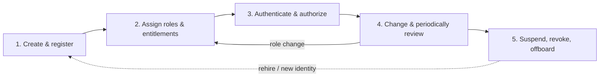

SSO centralizes application authentication; MFA adds assurance. Non-human identities (service accounts, API keys, workload identities) need the same lifecycle discipline. They are often more numerous than human accounts and less well governed.

### 2.2 Modern Authentication and MFA

Not all authentication methods offer the same protection.

| Method | Typical Use | Security Consideration |
|---|---|---|
| Password | Legacy applications | Vulnerable to theft, reuse, and phishing |
| SMS OTP | Supplemental authentication | Phishable; also exposed to SIM-swap and interception |
| TOTP | Supplemental authentication | Phishable through real-time relay (AiTM) proxies |
| Push MFA | Interactive authentication | Subject to fatigue attacks; require number matching |
| FIDO2 / WebAuthn (passkeys) | User authentication | Phishing-resistant; bound to the origin |
| Certificate / smart card (PIV) | User authentication | Can be phishing-resistant when implemented with appropriately bound authentication and validated certificates; hardware-backed keys strengthen protection |
| EAP-TLS | Network admission | Mutual certificate authentication; **not** user MFA by itself |
| mTLS | Service-to-service communication | Authenticates both communicating endpoints |

For sensitive systems, prefer **phishing-resistant** authentication.

> ⚠️ **Important:** A successful EAP-TLS device-certificate authentication does **not** prove that the person at the keyboard completed MFA. Device authentication and user authentication are related but distinct controls.

### 2.3 RBAC, ABAC, and Conditional Access

**Role-Based Access Control (RBAC)** authorizes based on assigned roles. **Attribute-Based Access Control (ABAC)** extends decisions with attributes such as:

- User identity and role
- Device compliance
- Resource sensitivity
- Authentication strength
- Access location and context
- Behavioral risk
- Time and session conditions

**Example:** a research administrator may reach a laboratory management application only from an approved, compliant device and only after phishing-resistant MFA.

> A compliant device must not automatically receive privileged access to every resource.

### 2.4 Privileged Access Management

Administrative accounts need additional protection:

- **Just-in-Time (JIT)** privilege elevation
- **Just Enough Administration (JEA)**
- Privileged-session recording and auditing
- Approval workflows
- Short-lived credentials
- Dedicated administrative access paths (for example, privileged access workstations)

Emergency break-glass accounts must also be protected, monitored, alerted on when used, and reviewed.

---

## 3. IEEE 802.1X and Network Admission Control

### 3.1 Why 802.1X Still Matters

IEEE 802.1X provides port-based network access control for wired and wireless enterprise networks. It remains relevant because it answers a question that application-level Zero Trust controls do not:

> **Should this device be admitted to the enterprise network at all?**

| Component | Function |
|---|---|
| **Supplicant** | Endpoint requesting network access |
| **Authenticator** | Switch, wireless AP, or controller that enforces admission |
| **Authentication Server** | RADIUS server that validates credentials and returns authorization |

The authenticator relays EAP messages between the supplicant (EAPOL on the LAN) and the authentication server (EAP encapsulated in RADIUS).

### 3.2 EAP-TLS and Certificate-Based Authentication

EAP-TLS is generally preferable to password-based EAP methods for managed devices. It uses PKI to authenticate **both** the endpoint and the RADIUS server with certificates.

```mermaid
sequenceDiagram
    autonumber
    participant S as Supplicant (Endpoint)
    participant A as Authenticator (Switch / AP)
    participant R as RADIUS / NAC
    participant P as PKI (CRL / OCSP)
    participant M as MDM / EDR

    S->>A: Link up / associate
    A->>S: EAP-Request/Identity
    S->>A: EAP-Response/Identity
    A->>R: RADIUS Access-Request (EAP)
    R-->>S: EAP-TLS: server certificate (relayed)
    Note over S: Validate server cert chain<br/>and expected server name
    S-->>R: EAP-TLS: client certificate + proof of key possession (relayed)
    R->>P: Check revocation status
    P-->>R: Certificate good
    R->>M: Query device compliance (optional; integration-dependent)
    M-->>R: Compliant (when supported)
    R->>A: Access-Accept + VLAN / ACL / role attributes
    A->>S: EAP-Success, port authorized
    A->>R: Accounting-Start (session ID)
```

A typical deployment requires:

- An enterprise or otherwise trusted certificate authority
- Secure certificate enrollment (for example SCEP or EST through MDM, or AD CS auto-enrollment)
- Device or user certificates, according to policy, with private keys protected by TPM or Secure Enclave where possible
- **Strict server certificate validation** on the supplicant: configure the approved CA trust anchors and validate the expected authentication-server identity (for example, server name). CA trust configuration is not the same as pinning an individual certificate. Without these checks, rogue APs can impersonate the authentication infrastructure.
- Certificate renewal and revocation processes
- RADIUS infrastructure that supports EAP-TLS (EAP-TLS 1.3 per RFC 9190 where the supplicant and server support it)

**Migrating from PEAP-MSCHAPv2.** Legacy PEAP-MSCHAPv2 deployments should be planned for migration to certificate-based authentication. On eligible Windows 11 22H2 and later devices, Credential Guard may be enabled by default; when enabled, it disrupts single sign-on for MSCHAPv2-based Wi-Fi and VPN authentication. Microsoft recommends moving to certificate-based methods such as EAP-TLS, PEAP-TLS, or TEAP.

### 3.3 Hardening the Admission Path

802.1X is only as strong as the infrastructure around it.

| Risk | Mitigation |
|---|---|
| **Blast-RADIUS (CVE-2024-3596):** on-path forgery of RADIUS responses over UDP | Patch affected RADIUS servers and NADs; configure both ends to **send, require, and validate Message-Authenticator** where applicable (especially Access-Request and Access-Accept/Reject/Challenge); test every proxy/hop and device family; isolate transport; consider RADIUS over TLS (RadSec) |
| **Wired 802.1X bypass:** an attacker bridges a rogue device behind an authenticated port | MACsec (IEEE 802.1AE with MKA) on wired links where supported; single-host or multi-auth host modes; physical port security |
| **Rogue access points / credential capture** | Enforce server certificate validation through managed supplicant profiles |
| **Weak Wi-Fi encryption** | WPA3-Enterprise (192-bit mode for high-security environments) |
| **Wi-Fi MAC address randomization** breaking MAB and profiling | Prefer certificate identity; manage randomization through MDM profiles on corporate SSIDs |

### 3.4 802.1X Authentication Is Not Permanent Trust

A common misconception is that 802.1X authenticates a device once and then trusts it indefinitely. In practice, network admission systems can use:

- Periodic reauthentication (for example the `Session-Timeout` attribute)
- Session expiration
- **RADIUS Change of Authorization (CoA)** and **Disconnect-Request** messages (RFC 5176, typically on UDP 3799)

However, 802.1X itself does **not** provide threat detection, application authorization, or comprehensive endpoint risk assessment. Those must come from complementary systems.

---

## 4. Dynamic VLAN Assignment: From Static Segmentation to Identity-Aware Network Access

### 4.1 Limitations of Static VLANs

Traditional networks assign VLANs to physical switch ports. This is simple, but it becomes hard to manage when employees change offices, devices move, or many endpoint types share the same infrastructure.

Dynamic VLAN assignment lets the authorization system choose a VLAN (or a role or ACL) based on the authenticated identity and endpoint attributes rather than a manually configured port.

| Endpoint Category | Example VLAN | Intended Access |
|---|---|---|
| Managed staff | 110 | Authorized corporate services |
| Research devices | 120 | Approved laboratory systems |
| IoT / printers | 130 | Specific management services only |
| Guests | 140 | Internet-only access |
| Quarantine | 199 | Restricted remediation services |

*VLAN IDs are illustrative and must be adapted to the actual network design.*

### 4.2 Dynamic VLAN Authorization Flow

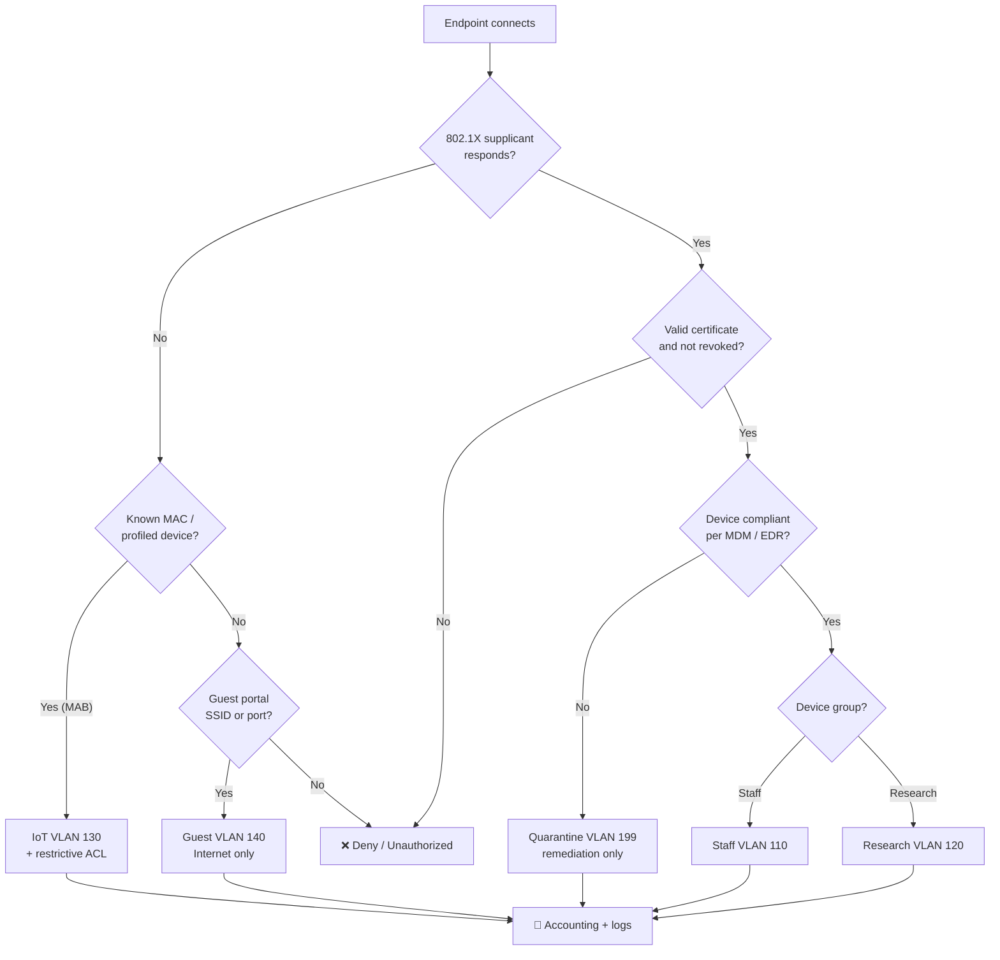

Step by step:

1. The endpoint connects to a managed switch port or enterprise SSID.
2. The supplicant starts or answers an EAP exchange.
3. The authenticator relays EAP messages to RADIUS.
4. The authentication server validates the certificate or other approved credentials.
5. The authorization policy selects the network access profile.
6. RADIUS returns **Access-Accept** with authorization attributes.
7. The switch or wireless infrastructure enforces the VLAN, ACL, or role.
8. Accounting and security logs record the session.

The endpoint then obtains IP connectivity (usually DHCP) on its assigned network.

### 4.3 Standard RADIUS VLAN Attributes

RFC 3580 documents the standard RADIUS attributes used for VLAN assignment:

| Attribute | Number | Example Value |
|---|---:|---|
| Tunnel-Type | 64 | VLAN (13) |
| Tunnel-Medium-Type | 65 | IEEE-802 (6) |
| Tunnel-Private-Group-ID | 81 | `"110"` (VLAN ID or, on many platforms, VLAN name) |

These are **standard** RADIUS attributes, not Vendor-Specific Attributes (VSAs). Downloadable ACLs, security group tags, and role names, by contrast, are usually vendor-specific.

Illustrative FreeRADIUS reply attributes:

```text
Tunnel-Type := VLAN
Tunnel-Medium-Type := IEEE-802
Tunnel-Private-Group-ID := "110"
```

Actual syntax and switch behavior depend on the RADIUS implementation and network platform. The assigned VLAN must be provisioned on the relevant switching or wireless infrastructure and available along the intended path; an access port itself need not be a trunk. Confirm DHCP scope, inter-VLAN routing, and security policy for that segment.

### 4.4 Dynamic Authorization and Quarantine

A risk-aware NAC system can use several authorization states:

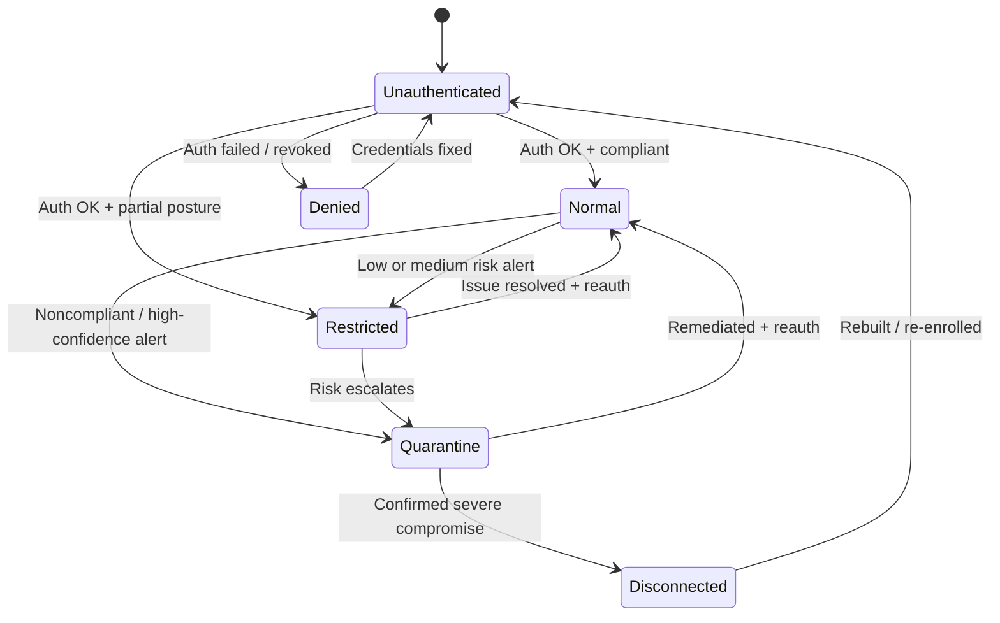

When an endpoint becomes noncompliant, a security orchestration service can request a session change through **RADIUS CoA**. Depending on the platform, the network may:

- Apply or replace an ACL on the existing session
- Force **reauthentication** (so the new policy is returned in a fresh Access-Accept)
- Bounce or disable the port
- Disconnect the session

> 💡 **Operational tip:** A VLAN change in the middle of a session can break active connections and usually needs the endpoint to renew its IP address. Wired clients often don't notice a VLAN change at all unless the port is bounced. Changing ACLs or roles in place is often less disruptive than changing VLANs.

### 4.5 Why Dynamic VLANs Are Not Complete Zero Trust

VLANs define Layer 2 broadcast domains. They are not, by themselves, an access-control system.

- Endpoints **in the same VLAN** can still talk to each other directly unless you add controls (private VLANs, client isolation, port ACLs).
- **Different VLANs** can still talk through routing unless firewall policies or ACLs restrict that traffic.

Combine dynamic VLAN assignment with inter-VLAN firewall policy, endpoint isolation, application-aware authorization, and microsegmentation.

> 🎯 The design objective is to **reduce implicit connectivity**, not to multiply VLANs.

---

## 5. Integrating NAC with Zero Trust Policy Decisions

### 5.1 A Layered Architecture

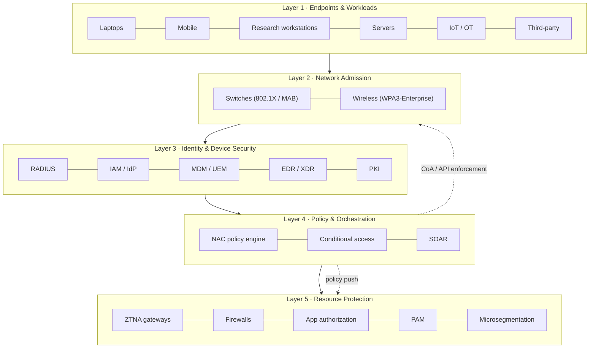

These layers are usually built from several systems rather than one central platform.

### 5.2 Dynamic Policy Decision Model

A mature policy combines **mandatory gates** with **contextual risk**. Some requirements must be absolute rather than just adding to a weighted score.

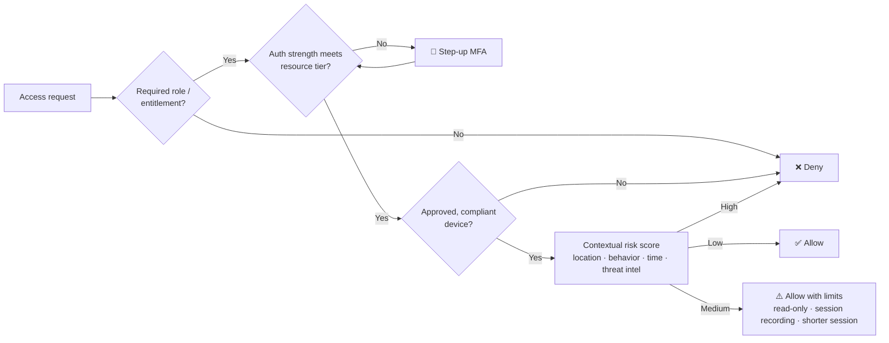

**Example:** a privileged management application requires a specific administrative role, phishing-resistant MFA, **and** an approved device. Missing any one of them blocks access, however favorable the other risk signals look.

### 5.3 Continuous Evaluation and Automated Response

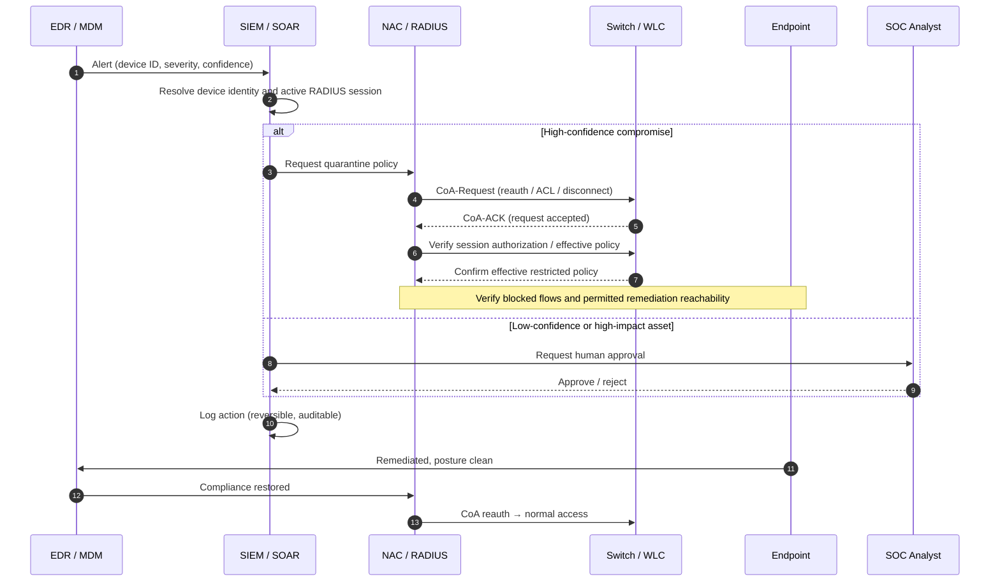

Automation only works if you can reliably map device identifiers to **active** network sessions. Typical correlation data:

`device ID` · `certificate subject / SAN` · `username` · `MAC address` · `switch / AP and port` · `RADIUS Acct-Session-Id` · `IP address` · `timestamps`

A CoA-ACK indicates that the request was accepted; it must not be the only success criterion. Confirm the active session and effective policy on the NAD, and validate expected traffic restrictions without interrupting critical services. The system must distinguish confirmed compromise from lower-confidence alerts so it does not cause unnecessary disruption.

---

## 6. Enterprise Deployment Scenarios

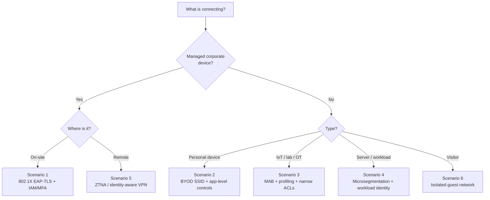

### Scenario 1: Corporate Wired and Wireless Networks

Managed employee computers use 802.1X EAP-TLS against enterprise RADIUS. NAC policies assign the network access profile based on device identity, organizational requirements, and compliance. Application access is controlled separately through IAM, MFA, and resource-specific authorization.

**✅ Security benefit:** Unauthorized devices can be denied at the network edge, while separately enforced application and network policies limit authenticated users to approved resources.

### Scenario 2: BYOD and Personal Devices

Personal devices may not support enterprise agents or full management. Provide a dedicated BYOD network and grant access to approved applications through SSO, conditional access, browser-based controls, or ZTNA. Certificate-based Wi-Fi can be used if an acceptable enrollment process exists.

- A captive portal alone is **not** proof of endpoint health.
- Protect enterprise data through application and data controls (for example MAM, DLP, session controls) rather than assuming personal devices can be managed like corporate workstations.

### Scenario 3: IoT and Agentless Research Equipment

IoT devices, laboratory instruments, printers, and industrial controllers often can't run 802.1X. **MAC Authentication Bypass (MAB)** can provide a controlled fallback admission path, and passive profiling helps identify device categories and spot unexpected behavior. MAB should be limited to explicitly approved endpoints and paired with restrictive authorization, monitoring, and periodic exception review.

> ⚠️ MAC addresses and behavioral fingerprints are **not** cryptographically strong identities.

Give these devices narrowly scoped access. For example, a laboratory controller may talk to its designated management server but must not reach general workstations or administrative systems.

**✅ Security benefit:** A compromised or spoofed device has far fewer lateral-movement paths.

### Scenario 4: Data Centers and Workload Security

Data center security needs more than VLAN-based server admission. Where it is supported and operationally suitable, 802.1X can authenticate physical server connections. East-west workload traffic should also be governed by host firewalls, network firewalls, SDN policies, cloud security groups, or microsegmentation agents. Application and database privileges are enforced by their own authorization systems.

For cloud-native workloads, service identities, mTLS, and frameworks such as **SPIFFE/SPIRE** provide identity-based service authentication (see NIST SP 800-207A).

### Scenario 5: Remote Access and Hybrid Work

Remote access uses a different enforcement model. A user working from home never meets an enterprise switch port, so 802.1X doesn't apply. Access is controlled by identity-aware VPN or ZTNA infrastructure that combines user authentication, device posture, and per-resource authorization.

- **ZTNA** publishes specific applications without granting broad internal reachability.
- **Traditional VPN** stays relevant for some administrative, laboratory, legacy-protocol, and specialized network use cases, ideally with posture checks and per-group access policies.

### Scenario 6: Guest Network Access

Guest access should be simple, isolated, and expire predictably:

- Dedicated guest SSIDs and network segments
- Captive portal or sponsored guest registration
- Time-limited credentials
- Internet-only access by default
- Restricted application access only where explicitly approved
- Client isolation and bandwidth management

> Captive portal authentication is **not** an 802.1X EAP exchange, and guest access must never imply access to internal resources.

---

## 7. Microsegmentation and East-West Traffic Protection

Microsegmentation limits communication between endpoints, applications, or workloads to what the business actually requires.

| Approach | How it works | Examples |
|---|---|---|
| **Network-based** | Constrains traffic between segments | Firewalls, routed ACLs, security groups, SDN policy |
| **Host-based** | Restricts traffic on the host, wherever it sits on the network | Windows Firewall, nftables/iptables, EDR host firewall |
| **Application-aware** | Enforces by identity and application, not just IP/port | App proxies, service mesh, workload identity |

**Recommended rollout:**

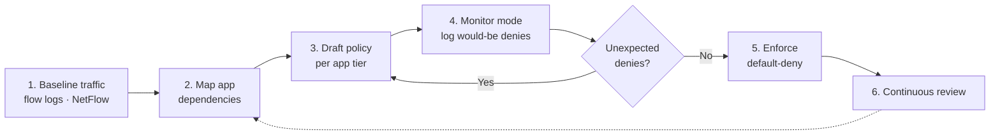

> ⚠️ Switching a large environment to default-deny all at once can cause major outages if application dependencies aren't understood.

---

## 8. Practical Implementation: A Phased Deployment

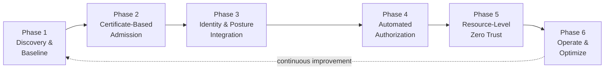

### Phase 1: Discovery and Baseline Assessment

- Inventory identities, endpoints, network infrastructure, applications, critical resources, and unmanaged devices.
- Document the current authentication architecture, VLANs, firewall rules, PKI, and monitoring.
- Identify areas of implicit network trust.

**📦 Deliverables:** asset inventory, network access matrix, current-state architecture, prioritized risk register.

### Phase 2: Implement Certificate-Based Network Admission

- Run a controlled 802.1X EAP-TLS pilot for managed devices, starting in **monitor / open mode** (log failures without blocking).
- Integrate certificate issuance and configure RADIUS, with Message-Authenticator enforced.
- Validate authentication, certificate expiry, revocation, roaming, and RADIUS high availability.
- Move to low-impact, then closed mode.
- Introduce dynamic VLANs or access profiles where appropriate.

**📦 Deliverables:** working pilot, RADIUS policy configuration, certificate lifecycle process, rollback plan.

### Phase 3: Extend Identity and Device Posture Integration

- Connect IdP, MDM, and EDR telemetry to the NAC policy workflow.
- Establish reliable device ↔ user ↔ session mapping.
- Define access states: compliant, restricted, quarantined, unauthorized.
- Give unmanaged and unsupported devices an explicit exception model.

**📦 Deliverables:** device classification policy, posture assessment model, exception register.

### Phase 4: Automate Authorization Changes

Test automated response to selected **high-confidence** events:

1. A managed laptop authenticates through EAP-TLS.
2. RADIUS assigns its normal authorization.
3. EDR detects a high-confidence compromise.
4. Orchestration correlates the endpoint with its active RADIUS session.
5. The network applies an approved restriction through CoA.
6. The team verifies that prohibited access is blocked.
7. Remediation and reauthorization restore normal access.

For isolation, prefer restricted remediation policies when safe; a confirmed severe compromise may require full disconnection.

> 🚫 Do not leave RDP or other administrative protocols open to compromised endpoints by default. Give responders access through EDR live-response or a dedicated, tightly scoped path.

**📦 Deliverables:** automated response workflow, policy tests, event timeline, recovery procedures.

### Phase 5: Introduce Resource-Level Zero Trust

- Application-specific ZTNA
- Conditional access and phishing-resistant MFA
- Privileged access workflows
- East-west microsegmentation
- Workload authentication
- Centralized security telemetry and audit trails

**📦 Deliverables:** resource authorization matrix, segmentation policy, ZTNA pilot, operational runbook.

### Phase 6: Operationalize and Optimize

- Move from project to continuous governance.
- Assign owners for access policies, certificates, exceptions, logging, and remediation.
- Review policies regularly and test their behavior during infrastructure failures and incident-response exercises.

---

## 9. Example Implementation: RADIUS and Dynamic VLAN Authorization

Consider a managed endpoint that has authenticated with EAP-TLS. The authorization system places it in the managed-staff category and confirms it meets the admission policy. The following is a **conceptual RADIUS attribute listing**, not a raw packet capture or syntax to paste into a RADIUS server:

```text
Access-Accept
    Message-Authenticator   = <computed integrity value>
    Tunnel-Type             = VLAN
    Tunnel-Medium-Type      = IEEE-802
    Tunnel-Private-Group-ID = "110"
    Session-Timeout         = 28800
```

`Message-Authenticator` is a computed packet-integrity attribute, not a human-entered literal value; its use and enforcement must follow the RADIUS implementation and security guidance. The switch or wireless infrastructure applies the VLAN if it is supported and correctly configured. If the device later becomes noncompliant, the policy system can request a different authorization through RADIUS CoA or an equivalent network API.

<details>
<summary><b>🔧 Illustrative switch configuration (Cisco IOS-XE, legacy authentication syntax)</b></summary>

> **Lab-only skeleton.** Prerequisites include reachable RADIUS servers, the matching server-side client definitions, secured shared secrets, VLAN/ACL design, server-side policy, management access, recovery testing, and platform-specific handling of unavailable authentication servers. This is deliberately not a copy-and-deploy configuration.

```text
aaa new-model
aaa authentication dot1x default group RADIUS-NAC
aaa authorization network default group RADIUS-NAC
aaa accounting dot1x default start-stop group RADIUS-NAC
!
radius server NAC-1
 address ipv4 10.10.10.11 auth-port 1812 acct-port 1813
 key <shared-secret>
!
aaa group server radius RADIUS-NAC
 server name NAC-1
!
aaa server radius dynamic-author
 client 10.10.10.11 server-key <shared-secret>
!
dot1x system-auth-control
!
interface GigabitEthernet1/0/10
 switchport mode access
 switchport access vlan 999
 authentication host-mode multi-auth
 authentication order dot1x mab
 authentication priority dot1x mab
 authentication port-control auto
 authentication periodic
 authentication timer reauthenticate server
 mab
 dot1x pae authenticator
 spanning-tree portfast
```

Many modern Catalyst IOS-XE deployments use IBNS 2.0 (`access-session` and control policy maps) rather than this legacy style. Choose the syntax supported by the specific hardware, software release, and operating mode; do not combine incompatible templates on an interface. The sample also does **not** enable strict Message-Authenticator validation on its own—configure and test that separately where supported.

</details>

<details>
<summary><b>🧪 Lab-testing CoA with <code>radclient</code> (FreeRADIUS utilities)</b></summary>

```bash
# Disconnect a session (RFC 5176 Disconnect-Request)
echo 'Acct-Session-Id = "0A0A0A1400000123"' \
  | radclient -x 10.20.0.2:3799 disconnect '<coa-secret>'

# Cisco-specific reauthenticate (vendor VSA - platform dependent)
cat <<'EOF' | radclient -x 10.20.0.2:3799 coa '<coa-secret>'
Acct-Session-Id = "0A0A0A1400000123"
Cisco-AVPair = "subscriber:command=reauthenticate"
EOF
```

Run this only against **authorized lab** switches. Restrict which hosts may send CoA (commonly UDP 3799), use strong shared secrets or an appropriately secured transport where supported, validate session identifiers against live accounting records, and verify the result on the NAD. Do not copy these session IDs to production.

</details>

**✅ Pre-production checklist**

- [ ] Switch and software support for the required CoA actions
- [ ] Behavior of existing sessions during authorization changes
- [ ] Whether ACL updates, role changes, or VLAN changes are supported
- [ ] DHCP and IP connectivity after VLAN changes
- [ ] RADIUS accounting and session identification
- [ ] Multi-device port behavior (IP phone + PC, hubs, docks)
- [ ] Interaction with voice VLANs, AP uplinks, and special-purpose ports
- [ ] Message-Authenticator sent, required, and validated on both sides, including RADIUS proxies where applicable
- [ ] Recovery procedures for RADIUS or policy-system outages (critical VLAN / critical auth)
- [ ] Evidence that CoA restrictions actually change the active session and block prohibited flows
- [ ] Controlled rollback and management-plane access during misconfiguration or policy outages

> Vendor-specific configurations must be tested on the deployed platform and firmware, not copied from generic examples.

---

## 10. Security Monitoring, Incident Response, and Policy Automation

Zero Trust needs more than successful authentication logs. A useful monitoring strategy correlates:

| Data Source | Relevant Signals |
|---|---|
| RADIUS / NAC | Authentication, authorization, CoA, session changes |
| IAM / IdP | Sign-in activity, MFA results, account risk |
| MDM / UEM | Enrollment and compliance status |
| EDR / XDR | Endpoint compromise and incidents |
| Firewall / Network | Connection metadata, policy violations |
| ZTNA / Application | Resource access and authorization decisions |
| SIEM / SOAR | Correlation, investigation, response |

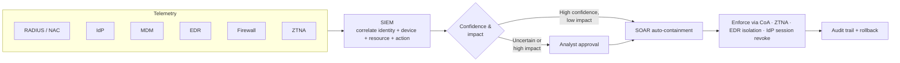

The monitoring system should connect **the identity**, **the device**, **the resources accessed**, and **the actions performed**. High-confidence alerts may trigger automated containment; uncertain or high-impact actions should need human approval.

> Response automation must be **reversible** and **auditable**.

---

## 11. Reliability, Security, and Operational Considerations

### 11.1 High Availability

RADIUS and network admission systems become critical dependencies.

- Deploy redundant authentication services across failure domains.
- Test switch behavior when RADIUS is unreachable (critical VLAN, critical authentication, inaccessible-server handling).
- Define **fail-open**, **fail-restricted**, or **fail-closed** behavior per resource sensitivity and business continuity needs.

### 11.2 PKI and Certificate Lifecycle

Certificate-based authentication brings operational requirements: enrollment, private-key protection, expiration, renewal, trust chains, and revocation (CRL/OCSP availability). Automate the lifecycle wherever practical, and monitor upcoming expirations, both endpoint certificates and the RADIUS server certificate.

### 11.3 Legacy Devices and Exceptions

Exceptions should be:

- ✅ Narrowly scoped
- ✅ Owned by a named person
- ✅ Logged
- ✅ Reviewed regularly
- ✅ Retired when no longer needed

In industrial or research environments, network changes must take safety, availability, and equipment vendor requirements into account.

### 11.4 Operational Guardrails for Automated Isolation

- Identify critical infrastructure, lab instruments, safety-related controls, shared ports, and break-glass paths before permitting automated enforcement.
- Require a confidence threshold and approval workflow appropriate to asset criticality and business impact.
- Correlate endpoint identity to the **current** session; MAC address or IP address alone is insufficient for reliable attribution.
- Verify enforcement with session state and network telemetry; monitor for stale sessions, CoA-NAK, timeouts, or silent policy mismatches.
- Log who or what initiated containment, the change applied, evidence of its effectiveness, and a documented reversal process.

### 11.5 Performance and Policy Scale

Evaluate authentication latency, RADIUS response times, CoA reliability, concurrent sessions, roaming, policy propagation, and log ingestion capacity.

> Policy complexity should never exceed the organization's ability to operate and troubleshoot it.

---

## 12. Measuring Zero Trust Deployment Success

Measure operational and security outcomes, not the number of products deployed.

| Metric | Objective |
|---|---|
| 802.1X coverage | % of eligible devices using secure authentication |
| EAP-TLS adoption | Less legacy password-based network authentication |
| Managed endpoint coverage | Visibility into enrolled and compliant devices |
| Unauthorized admission prevention | Effectiveness of edge controls |
| Segmentation coverage | Critical resources protected by least-privilege policy |
| Incident containment time | Time from confirmed risk to effective isolation |
| Authorization change success | Reliability of CoA and network enforcement |
| False isolation rate | Unnecessary outages caused by automation |
| Certificate renewal success | Reliability of the device authentication lifecycle |
| Exception age | Duration and governance of exceptional access |

Validate metrics against real test scenarios rather than assuming them from product capabilities.

---

## 13. Common Implementation Mistakes

| # | Mistake | Reality |
|---|---|---|
| 1 | Treating 802.1X as a complete Zero Trust solution | It controls network admission, not application or data authorization. |
| 2 | Equating EAP-TLS with user MFA | Device certificates and phishing-resistant user authentication solve different problems. |
| 3 | Assuming dynamic VLANs provide microsegmentation | VLANs create boundaries but don't enforce least privilege between endpoints or apps. |
| 4 | Treating MAC authentication as strong identity | MAB is a practical fallback but is easy to spoof. |
| 5 | Assuming all security products integrate automatically | Dynamic enforcement needs supported APIs, session correlation, compatible hardware, and explicit workflows. |
| 6 | Aggressive isolation without understanding business impact | Account for shared ports, legacy devices, critical research systems, and recovery. |
| 7 | Assuming Zero Trust eliminates VPNs | ZTNA improves per-app access, but specialized use cases may still need tightly controlled VPN. |
| 8 | Skipping supplicant server-certificate validation | Leaves users open to rogue APs and credential capture. |
| 9 | Leaving RADIUS unpatched or without Message-Authenticator | Exposes the admission path to Blast-RADIUS-style forgery. |

---

## 14. Future Direction: Identity-Aware and Risk-Adaptive Network Security

The evolution of enterprise network security is not about abandoning established protocols. It is about integrating authentication, endpoint protection, network enforcement, and resource authorization.

Areas of active development:

- 🔐 Phishing-resistant authentication and hardware-bound device identity
- 📈 Risk-adaptive network authorization
- 🔗 Correlation of endpoint and identity telemetry
- 🤖 Automated containment and policy orchestration
- 🧩 Identity-aware microsegmentation
- 🏷️ Workload identity and certificate automation
- 📜 Policy as Code and continuous policy validation
- 🔒 RADIUS transport hardening (RADIUS over TLS)
- ☁️ Consistent access decisions across on-premises and cloud

Dynamic VLANs and RADIUS CoA remain useful, but they work best as part of a larger architecture that protects applications, workloads, and sensitive data.

---

## 15. Conclusion

> **IEEE 802.1X is not obsolete. The assumption that successful network admission establishes lasting trust is obsolete.**

802.1X, EAP-TLS, RADIUS, and dynamic VLAN assignment still provide valuable security for wired and wireless enterprise networks. Their modern role is to provide a strong admission foundation that complements identity security, device risk evaluation, resource-level authorization, and continuous monitoring.

A successful Zero Trust strategy answers four questions:

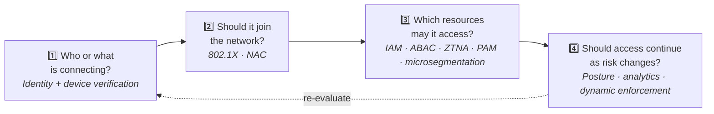

The long-term goal is an architecture in which every access decision is **explicit**, **appropriate to the resource**, **observable**, and **adjustable** when security conditions change.

Rather than replacing traditional NAC, Zero Trust expands its purpose: from controlling network entry to supporting continuous, identity-aware, least-privilege access across the enterprise.

---

## References and Further Reading

**Frameworks and guidance**

1. NIST SP 800-207, *Zero Trust Architecture*: https://doi.org/10.6028/NIST.SP.800-207
2. NIST SP 800-207A, *A Zero Trust Architecture Model for Access Control in Cloud-Native Applications in Multi-Location Environments*: https://doi.org/10.6028/NIST.SP.800-207A
3. NIST SP 1800-35, *Implementing a Zero Trust Architecture* (NCCoE, final, June 2025): https://doi.org/10.6028/NIST.SP.1800-35
4. CISA, *Zero Trust Maturity Model, Version 2.0*: https://www.cisa.gov/zero-trust-maturity-model

**Standards**

5. IETF RFC 3580, *IEEE 802.1X RADIUS Usage Guidelines*: https://www.rfc-editor.org/rfc/rfc3580
6. IETF RFC 5176, *Dynamic Authorization Extensions to RADIUS*: https://www.rfc-editor.org/rfc/rfc5176
7. IETF RFC 9190, *EAP-TLS 1.3*: https://www.rfc-editor.org/rfc/rfc9190
8. IETF RFC 6614, *TLS Encryption for RADIUS (RadSec)*: https://www.rfc-editor.org/rfc/rfc6614

**Vendor and security advisories**

9. Microsoft Learn, *Extensible Authentication Protocol (EAP) for Network Access in Windows*: https://learn.microsoft.com/en-us/windows-server/networking/technologies/extensible-authentication-protocol/network-access
10. Microsoft Learn, *Credential Guard Considerations and Known Issues*: https://learn.microsoft.com/en-us/windows/security/identity-protection/credential-guard/credential-guard-considerations
11. Blast-RADIUS (CVE-2024-3596) research and mitigations: https://blastradius.fail/
12. Cisco, *Blast-RADIUS Protocol Spoofing Mitigation*: https://www.cisco.com/c/en/us/support/docs/security/identity-services-engine/222287-blast-radius-cve-2024-3596-protocol-sp.html
13. Cisco, *IOS Security Command Reference: Authentication and 802.1X*: https://www.cisco.com/c/en/us/td/docs/ios-xml/ios/security/a1/sec-a1-cr-book/sec-cr-a3.html

---

<sub>This article consolidates material on Zero Trust Architecture, identity security, NAC integration, and dynamic VLAN assignment. Technical concepts were reviewed against selected referenced standards and vendor guidance; platform- and release-specific behavior still requires independent verification. All configuration examples are illustrative and need platform-specific validation before production use.</sub>
