# BGP Hijacking Explained: How It Happens and How to Defend Against It

> **TL;DR** — BGP hijacks are no longer just outages. In August 2026, an attacker diverted a vendor's update servers at the routing layer, obtained a valid TLS certificate, and pushed a malicious software update over HTTPS with no browser or client warning. Route Origin Validation said the bad route was *valid*. Defending against this takes layers: precise ROAs, route validation and filtering, external monitoring, and, most importantly, protecting what travels over the route with signed updates and certificate monitoring. *(Updated November 2026.)*

Between 28 and 30 August 2026, a small number of Virtualizor installations received a malicious software update over an HTTPS connection that showed no certificate warning. The attacker had diverted traffic at the internet routing layer and used that position to obtain a valid TLS certificate for the vendor's domains.

For a security operations center (SOC), the lesson is practical: **when internet routes change unexpectedly, investigate what users and systems may have received while traffic was diverted** — not just whether the service was reachable.

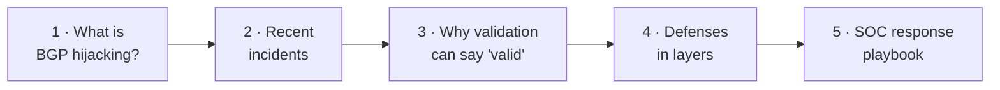

---

## 1. What is BGP hijacking?

The **Border Gateway Protocol (BGP)** lets independently operated networks, known as *autonomous systems* (ASes), tell one another which blocks of IP addresses they can reach. Those blocks are called *prefixes*. Internet providers, cloud platforms, and large enterprises use these announcements to route traffic between their networks.

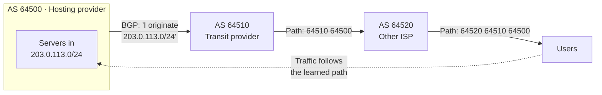

*(Example ASNs and prefixes use documentation ranges.)*

BGP was designed on trust. By default, a router believes what its neighbours announce. That is the root of two related problems:

- A **BGP hijack** occurs when an unauthorized announcement diverts traffic destined for an IP prefix. It can be a configuration mistake or a deliberate attack.
- A **route leak** occurs when a network passes a route beyond the scope allowed by routing policy. For example, it might re-announce routes learned from one provider to another provider or peer. RFC 7908 classifies these into types.

### Why a more-specific route wins

Routers forward traffic using the **longest matching prefix**. If a network accepts an unauthorized announcement for a smaller block inside a legitimate larger one, traffic to that smaller block follows the more specific route, wherever it was accepted. Hijacks of the *same* prefix length can also succeed, but only where the attacker's path looks shorter or more preferred, so they spread less widely.

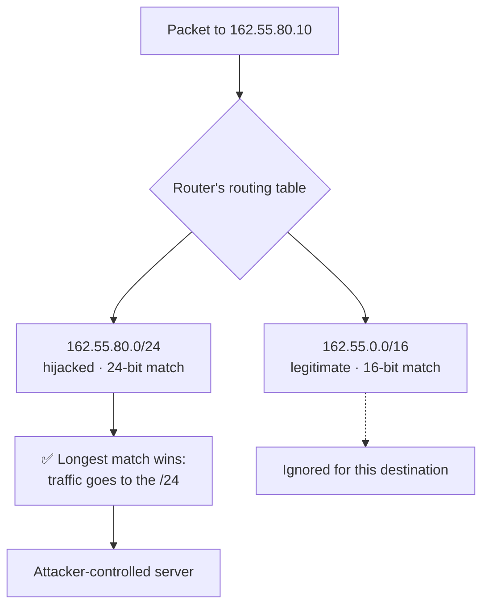

Depending on where the announcement spreads, users may lose access, see delays, or reach infrastructure controlled by an attacker. Hijacks and leaks can produce similar symptoms, so investigators need routing evidence to tell them apart:

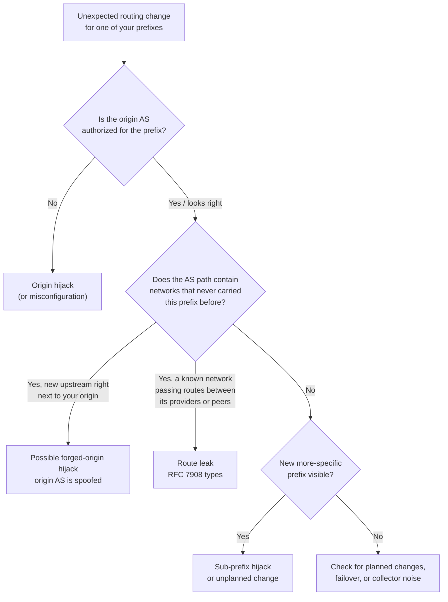

---

## 2. What recent incidents tell us

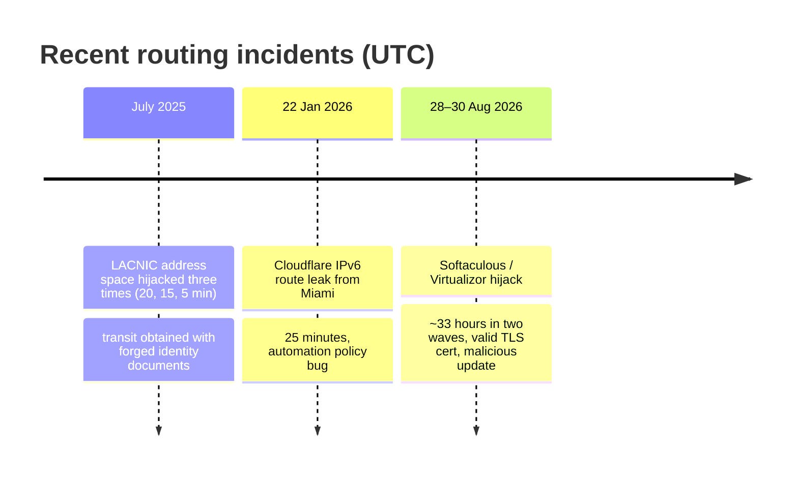

| Incident | What happened | What defenders should take from it |
|---|---|---|
| **28–30 Aug 2026 · Virtualizor / Softaculous** | AS62390 (NexonHost) announced `162.55.80.0/24`, a more-specific of Hetzner's `162.55.0.0/16`, through transit AS6204 (Zet.net). The attacker kept Hetzner's AS24940 as the **forged origin**. Diverted Let's Encrypt validation produced a valid certificate for `virtualizor.com`, `api.virtualizor.com`, and `files.virtualizor.com`. A malicious update reached a small number of installations. ROV returned **valid**: the origin matched and Hetzner's ROA allowed lengths up to `/24`. | Origin validation is not path validation. Watch for **new more-specifics** and **new upstreams next to your origin**. Keep ROA maxLength tight. Require **signed updates** that clients verify independently of TLS. Softaculous made package and API signing mandatory from v6.4.1. |
| **22 Jan 2026 · Cloudflare route leak** | An automated routing-policy change on one Miami router caused Cloudflare to leak **IPv6** prefixes to transit providers and peers: a mix of RFC 7908 **Type 3 and Type 4** leaks. It lasted about **25 minutes**, caused congestion between Miami and Atlanta, packet loss, and higher latency, and affected external networks as well as Cloudflare customers. | A configuration error can look like an attack. Check recent routing and automation changes early. Validate export policy in CI before deployment, not after. |
| **July 2025 · LACNIC address-space hijack** | An attacker impersonated the legitimate holder of an ASN, using forged documents and a look-alike domain, to get a multinational upstream to enable transit. They then injected three brief hijacks (about 20, 15, and 5 minutes) with spoofed origins, including LACNIC's space. The first sign was a user who could not send email. The upstream terminated the BGP session once APNIC, LACNIC, the Indonesian NIR (APJII/IDNIC), and the real ASN holder confirmed the fraud. | Providers must **verify customer identity and authority** over ASNs and prefixes before enabling transit. Retain historical routing data, because short hijacks disappear before anyone looks. Broad maxLength and networks that still accept *NotFound* routes made it worse. |

### Anatomy of the Virtualizor attack

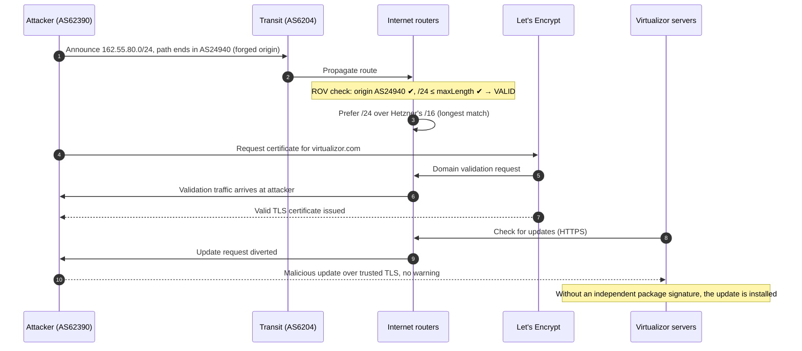

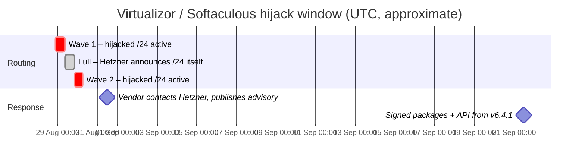

Two details stand out:

1. **The hijack was detectable from history alone.** Hetzner had never announced that `/24` on its own. One public monitor flagged it at 20:57:30 UTC on 28 August, seen by 176 peers across 24 collectors. The vendor learned from customers, not from its hosting provider.
2. **Multi-perspective certificate validation did not stop it.** Since 2025, CAs must check domain control from several network locations (*Multi-Perspective Issuance Corroboration*, MPIC). From 15 March 2026, that means at least three remote perspectives across two RIR regions. MPIC is effective against *localized* hijacks. A more-specific route that propagates widely can reach most of those vantage points, though. That is why application-layer signing still matters.

---

## 3. Why validation can say "valid"

**Route Origin Validation (ROV)** compares each announcement against Route Origin Authorizations (ROAs) published in the RPKI. It checks only two things: *who* is the origin AS, and is the prefix length within *maxLength*? It does not check the rest of the path.

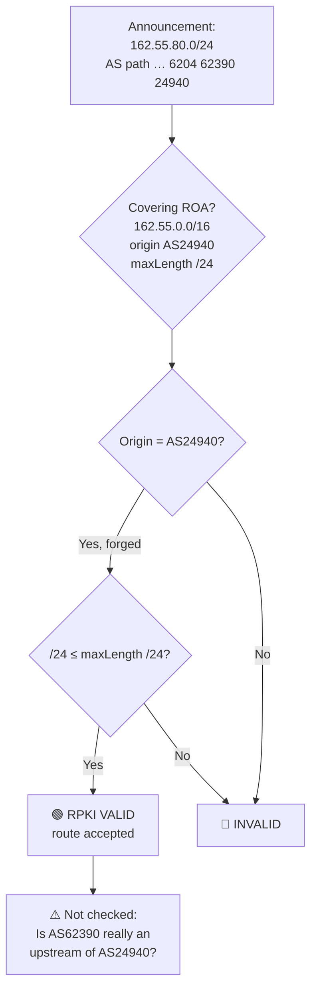

With a maxLength of `/16` (or a separate ROA only for prefixes actually announced), the forged `/24` would have been **RPKI-invalid** and dropped by networks enforcing ROV. That is the reason behind RFC 9319's advice to avoid broad maxLength values.

Closing the path gap is the job of **ASPA (Autonomous System Provider Authorization)**. Each AS publishes a signed list of its legitimate upstream providers, and validators can then flag paths that include an impossible provider relationship.

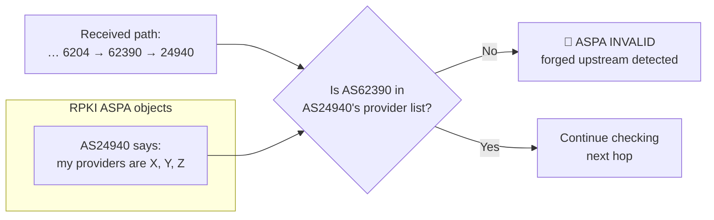

**Status (November 2026):** ASPA is still an **IETF Internet-Draft**. The verification draft has working-group consensus and is waiting for its write-up. The ASPA profile draft is on revision 31. Several RIRs and router and validator implementations already support creating and checking ASPA objects, so it is worth publishing ASPAs now and testing validation in monitor mode. Treat enforcement as early-adopter work. APNIC and LACNIC concluded that ASPA would have made the July 2025 attack far harder.

---

## 4. How to defend against BGP hijacking

No single control is enough. Think in layers, from the route itself up to what the user or system finally trusts:

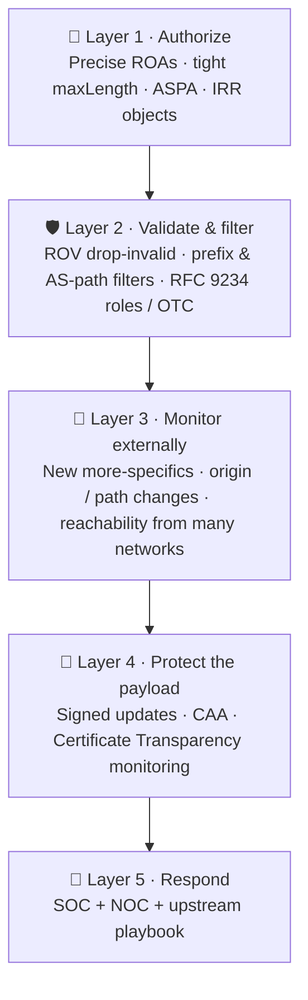

### 1) Publish precise route authorizations

If you control public IP space, publish **ROAs** in the RPKI for the networks that legitimately announce it.

- Authorize **only the prefixes and lengths you actually announce**. Avoid broad maxLength (RFC 9319).
- Coordinate ROA changes with routing changes, DDoS-scrubbing diversions, and planned failovers. Create the ROA before you announce.
- Publish **ASPA** objects listing your real upstream providers, and keep IRR route objects accurate.
- If your provider announces your addresses, as Hetzner did for Softaculous, ask who maintains the ROAs and what maxLength they use.

### 2) Validate routes and enforce routing policy

Network operators should run **ROV** and **reject RPKI-invalid** announcements, then apply import and export filters for each BGP neighbour (RFC 7454). Remember the limits: ROV checks only origin and length. Add:

- Prefix-list and AS-path filters for customers and peers.
- **BGP Roles and the Only-to-Customer (OTC) attribute (RFC 9234)** to prevent many route leaks automatically.
- Export-policy tests in your automation pipeline. The Cloudflare leak came from a merged code change.

If a provider announces your addresses, confirm that it enforces ROV, and know how to reach its network operations team during an incident.

### 3) Monitor routes from outside your network

A service can look healthy from headquarters while users on another provider are being diverted. Monitor from the outside:

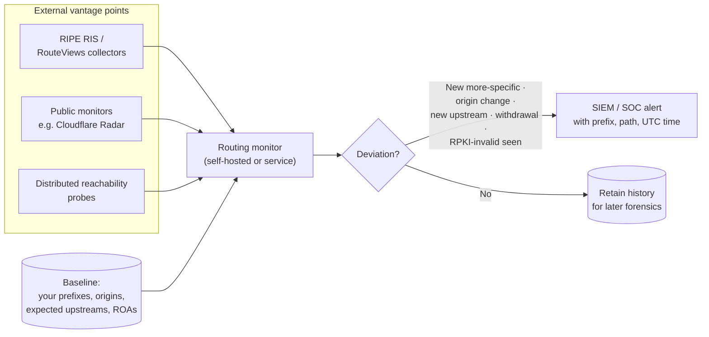

Alert on:
- Unexpected **origin** changes.
- **Newly visible more-specific** prefixes, the strongest signal in the Virtualizor case.
- **New upstream ASes adjacent to your origin.** This catches forged origins.
- Withdrawals affecting critical services.
- Your prefixes seen as RPKI-invalid.

Keep the history. Short hijacks such as the five-minute LACNIC event are gone before anyone looks.

### 4) Protect what travels over the route

Routing defenses reduce the chance of diversion. Payload defenses keep a diverted connection from turning into a compromise.

- **Sign software updates and verify the signature on the client**, using a key that is not tied to the TLS certificate. TLS shows you reached a server holding a valid certificate for the name. In a hijack, that can be the attacker's server.
- **Monitor Certificate Transparency (CT) logs** for unexpected certificates on critical domains, and alert on any issuance you didn't request.
- **Publish CAA records** limiting which CAs may issue for your domains. Use the `accounturi` and `validationmethods` parameters (RFC 8657) to tie issuance to your own CA account.
- For login and API endpoints, plan to **invalidate sessions and rotate credentials and API keys** used during any diversion window, as Softaculous did.

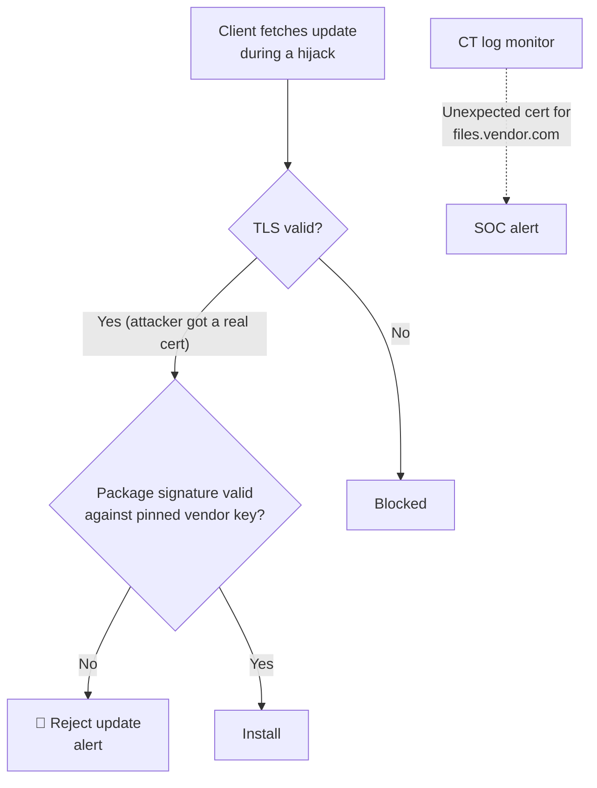

---

## 5. What the SOC should do when an alert fires

**Verify the route change, escalate to the network operator, and assess exposure, all in parallel.**

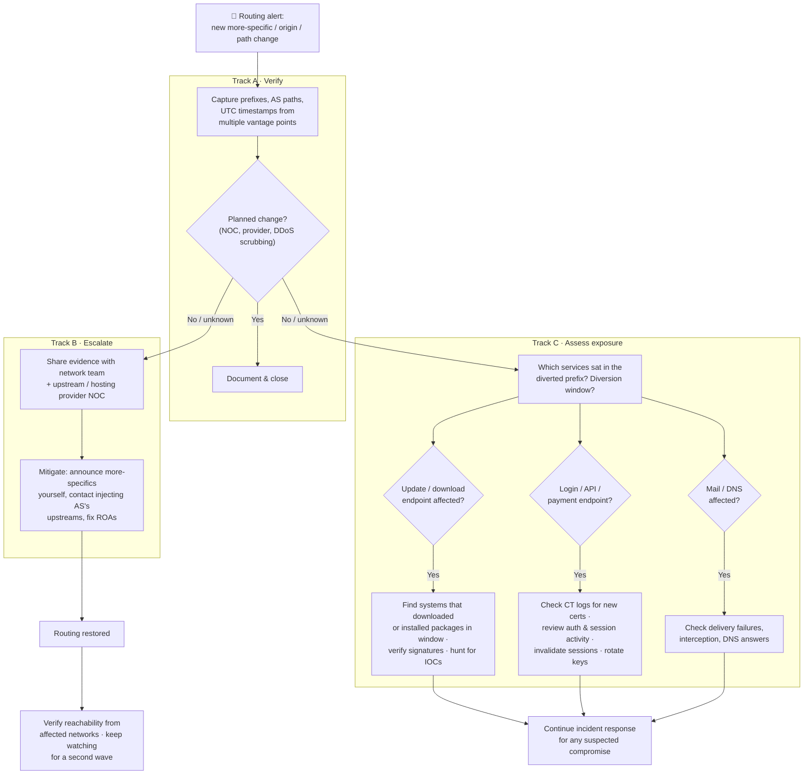

Step by step:

1. **Capture the evidence.** Record the affected prefixes, observed AS paths, and UTC timestamps from multiple vantage points, such as RIPE RIS or RIPEstat, and your monitor. Screenshots fade, and routing tables change.
2. **Check whether the change was planned**, then share the evidence with your network team and your upstream or hosting provider. Don't assume the provider has noticed. In the Virtualizor case, it hadn't notified the customer.
3. **Assess exposure at the same time.** Work out which services and users were in the diverted range and for how long.
   - **Update endpoint affected?** Determine which systems downloaded and installed packages during the window, and verify package signatures.
   - **Login, API, or payment endpoint affected?** Review certificate issuance in CT logs, authentication, and session activity. Invalidate sessions and rotate keys.
4. **After routing returns to normal**, verify reachability from affected networks. Keep watching: the Virtualizor hijack came back for a second wave after roughly 11 hours of quiet.
5. **Close the gaps.** Tighten ROAs and maxLength, publish ASPA, add more-specific and new-upstream alerts, and make signed updates mandatory with your vendors.

| Role | Owns |
|---|---|
| **SOC** | Alert triage, exposure assessment, CT monitoring, session and credential response, IOC hunting |
| **Network / NOC** | Route verification, ROA/ASPA changes, filters, mitigation announcements |
| **Upstream / hosting provider** | Filtering the bad route, contacting the injecting AS's upstreams |
| **Application / vendor owners** | Update signing, client-side verification, customer notification |

---

## References

**Incidents**
- Virtualizor — [Security incident: BGP hijacking](https://www.virtualizor.com/blog/security-incident-bgp-hijacking/)
- Softaculous — [Security incident – BGP hijacking – update](https://www.softaculous.com/blog/security-incident-bgp-hijacking-update/)
- BGPHorizon — [The August 2026 Virtualizor incident](https://bgphorizon.com/blog/virtualizor-bgp-hijack-august-2026)
- APNIC — [Latest BGP hijack targets hosting software vendor](https://blog.apnic.net/2026/09/22/latest-bgp-hijack-targets-hosting-software-vendor/)
- Cloudflare — [Route leak incident on January 22, 2026](https://blog.cloudflare.com/route-leak-incident-january-22-2026/)
- APNIC / LACNIC — [RPKI vs social engineering: A case study in route hijacking](https://blog.apnic.net/2026/03/31/rpki-vs-social-engineering-a-case-study-in-route-hijacking/)

**Standards and guidance**
- NIST SP 1800-14 — [Protecting the Integrity of Internet Routing: BGP Route Origin Validation](https://csrc.nist.gov/pubs/sp/1800/14/final)
- RFC 7908 — [Problem Definition and Classification of BGP Route Leaks](https://www.rfc-editor.org/info/rfc7908/)
- RFC 7454 — [BGP Operations and Security](https://datatracker.ietf.org/doc/html/rfc7454)
- RFC 9319 — [The Use of maxLength in the RPKI](https://www.rfc-editor.org/rfc/rfc9319.html)
- RFC 9234 — [Route Leak Prevention and Detection Using Roles in UPDATE and OPEN Messages](https://www.rfc-editor.org/rfc/rfc9234.html)
- RFC 8657 — [CAA Record Extensions for Account URI and ACME Method Binding](https://www.rfc-editor.org/rfc/rfc8657.html)
- IETF draft — [BGP AS_PATH Verification Based on ASPA Objects](https://datatracker.ietf.org/doc/draft-ietf-sidrops-aspa-verification/)
- ARIN — [NRO RPKI best practices](https://www.arin.net/blog/2025/09/25/nro-rpki-best-practices/)
- CA/Browser Forum — [Ballot SC-067: Multi-Perspective Issuance Corroboration](https://cabforum.org/2024/08/05/ballot-sc067v3-require-domain-validation-and-caa-checks-to-be-performed-from-multiple-network-perspectives-corroboration/)

**Tools**
- RIPE NCC — [Routing Information Service (RIS)](https://www.ripe.net/analyse/internet-measurements/routing-information-service-ris/)

*Diagrams are written in [Mermaid](https://mermaid.js.org/) and render natively on GitHub.*
