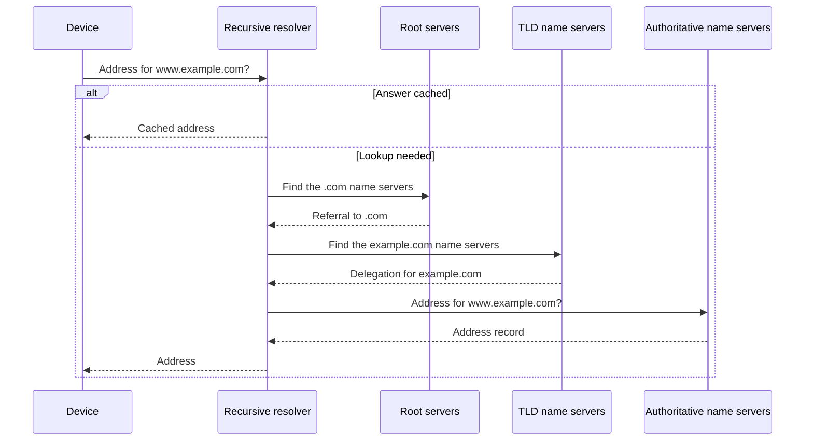
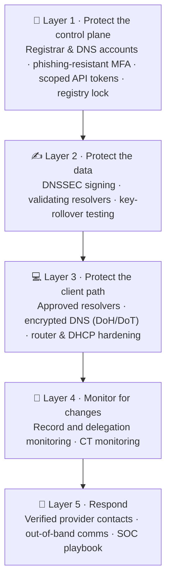
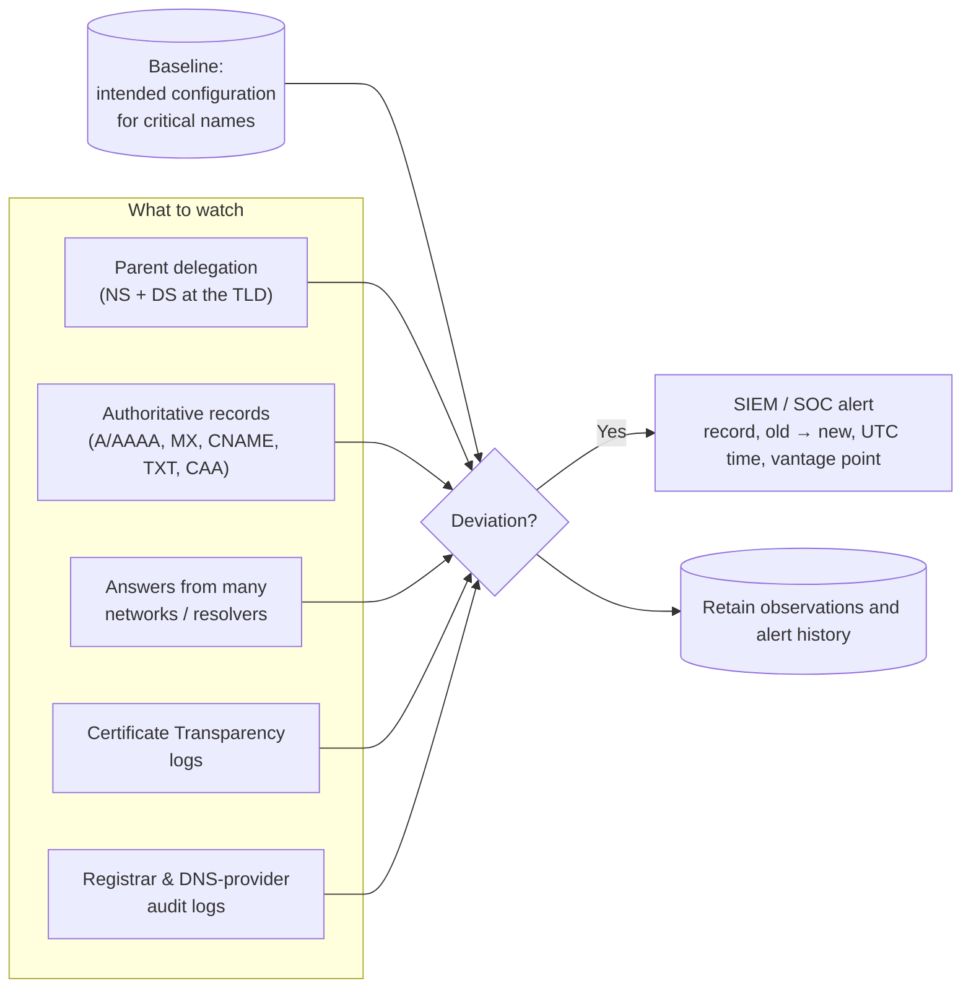
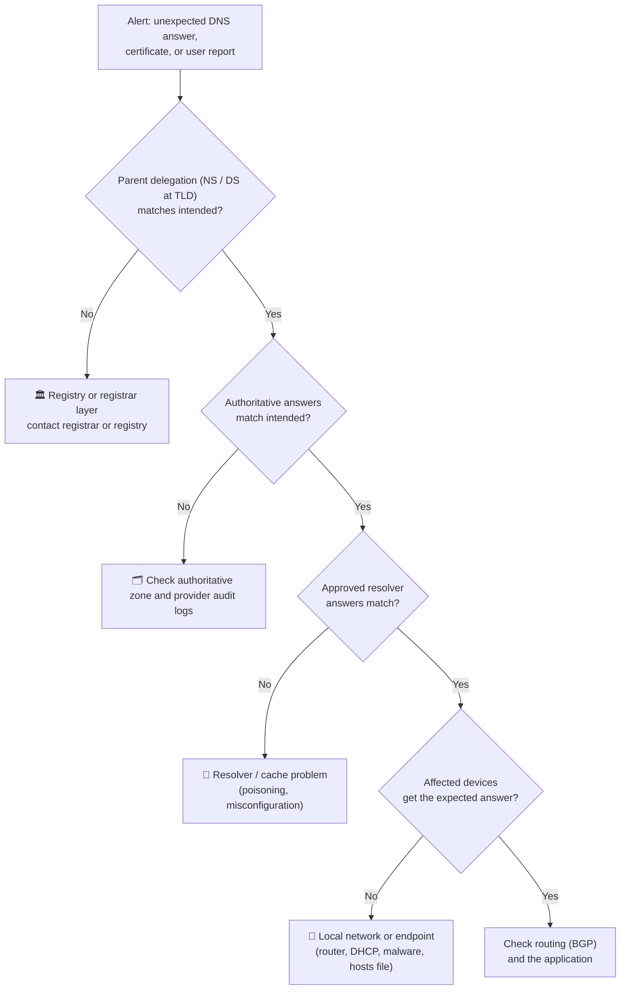
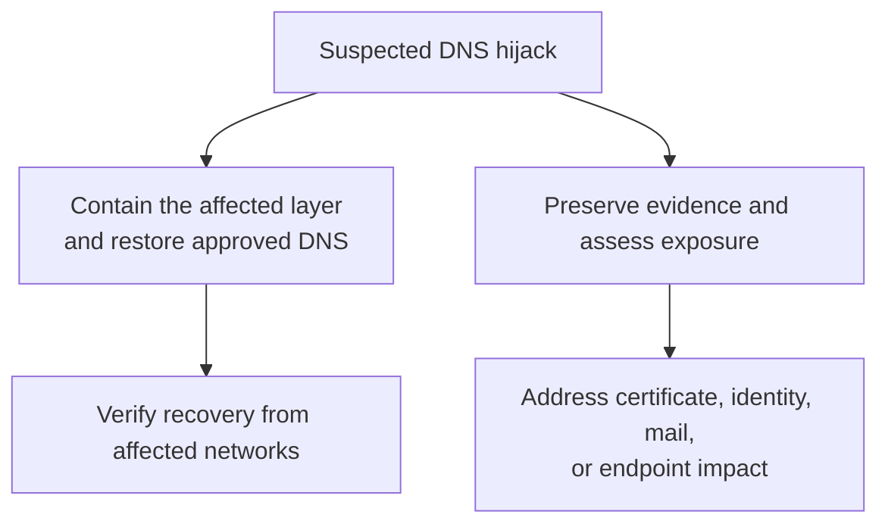

# DNS Hijacking Explained: How It Happens and How to Defend Against It

> **TL;DR** — DNS hijacking can send users and systems to an unintended destination even when they use the correct domain name. Attackers may redirect web or email traffic and, in some cases, obtain publicly trusted HTTPS certificates. Restore DNS and investigate what happened while traffic was diverted.

On 6 October 2026, Google disclosed that attackers had compromised the operators of three country-code top-level domains (ccTLDs), `.gh`, `.sl`, and `.as`. The attackers changed authoritative DNS records and obtained unauthorized HTTPS certificates for several Google domains and domains belonging to other organizations. [Google Chrome security disclosure][google]

---

## 1. What is DNS hijacking?

The **Domain Name System (DNS)** tells applications where to find services. When you open a website, your device asks a **recursive resolver** for the domain's address. The resolver returns a cached answer or follows referrals down the hierarchy until it reaches the domain's **authoritative name servers**, which publish the official records.

DNS also supports email delivery through **MX** records and domain-control checks through records such as **TXT** and **CNAME**. Certificate authorities (CAs) also consult **Certification Authority Authorization (CAA)** records before issuing publicly trusted TLS certificates. [NIST DNS deployment guide][nist], [CA/Browser Forum TLS Baseline Requirements][cab]

**DNS hijacking** happens when an attacker interferes with this process so that a legitimate domain leads somewhere the owner did not intend. A user can type the correct name and still reach a fake login page. The attack can also divert email or disrupt access to the service. [Canadian Centre for Cyber Security guidance][canada]

---

## 2. Where hijacks happen, and who can stop them

*Where* the attacker intervenes determines who is affected and which team can fix it.

| Where the change happens | What defenders may see | Who can fix it |
|---|---|---|
| **Registry** (TLD operator) | The parent zone's name server (NS) or Delegation Signer (DS) records change. Your registrar audit log may show no corresponding change. | Registry operator, often via your registrar. |
| **Registrar** | The domain's delegation changes, and resolvers are sent to a different set of authoritative name servers. The registrar audit log may show logins or API calls. | Your registrar, through a verified support channel. |
| **Authoritative DNS provider** | Delegation can stay the same while records for a website, login endpoint, or mail service change. | Your DNS team or provider. |
| **Resolver, network, or endpoint** | Public DNS may look correct while affected devices receive different answers. Investigate resolver configuration, router or DHCP settings, endpoint DNS settings, and possible cache poisoning. | Network, IT, or endpoint teams. |

A **dangling DNS record** is a related subdomain takeover risk. A record can keep pointing to a decommissioned cloud resource. If another tenant can claim that resource, they may serve content on the subdomain while DNS continues to return the configured answer. Remove dangling records and coordinate cleanup with the cloud team. [Microsoft guidance on subdomain takeover][azure]

### DNS hijack or BGP hijack?

**DNS** determines *which address* an application tries to reach. **BGP** helps determine *how traffic gets* to that address. If DNS answers match the intended configuration and users still reach an unexpected destination, check routing, the content delivery network (CDN), and application redirects. A changed traceroute is a lead to corroborate with BGP data and the network operator. [BGP Hijacking Explained](bgp-hijacking-explained.md), [NIST routing security guide][bgp]

---

## 3. Two recent incidents

### 6 October 2026 disclosure · Country-code registry hijacks

Google reported that attackers compromised third-party operators of the `.gh` (Ghana), `.sl` (Sierra Leone), and `.as` (American Samoa) country-code namespaces. The attackers modified authoritative DNS records and obtained unauthorized certificates for selected domains. Chrome blocked identified certificates and Google worked with the issuing CAs to revoke them. Google did not identify the initial compromise method in its disclosure. [Google Chrome security disclosure][google]

The registry sits above the domain owner's registrar and DNS provider. Monitor certificate issuance across your entire domain portfolio, including regional and parked domains. Correlate unexpected issuance with DNS and access logs to determine whether anyone used the certificate to intercept traffic. [Google's guidance for domain owners][google]

### 12 May 2025 · Curve Finance registrar-level hijack

Curve reported that attackers gained access to systems at its registrar and changed the DNS delegation for `curve.fi`. The exact access method was still under investigation when Curve published its report. Visitors reached a look-alike page that prompted them for wallet signatures. Curve reported that its smart contracts remained operational. [Curve Finance incident report][curve]

Curve escalated upstream, the affected domain was pointed to neutral name servers, and the team moved its web interface to `curve.finance` while pursuing recovery. Keep verified provider escalation contacts and an independent way to warn users when the affected domain can no longer be trusted. [Curve Finance incident report][curve], [Australian Cyber Security Centre guidance for domain owners][acsc]

---

## 4. How to defend against DNS hijacking

Network, identity, and security operations center (SOC) teams each have a role in prevention and response.

### Protect the accounts that can change DNS

- Require **phishing-resistant MFA** (passkeys or FIDO2 security keys) for registrar and DNS-provider administrators.
- Use **named administrator accounts**. Restrict API tokens to the zones and actions they need, and review access regularly.
- For critical domains, ask what **registry lock** covers, including NS and DS updates, and how unlock requests are authenticated. A transfer-only lock addresses registrar transfers. Registry lock depends on the registry's own controls. [Australian Cyber Security Centre guidance][acsc], [Verisign Registry Lock documentation][lock]
- Remove DNS mappings before decommissioning cloud resources, and allow cached mappings to expire before releasing reusable resources where practical. [Microsoft guidance on dangling DNS records][azure]

### Sign authoritative zones and use validating resolvers

**DNS Security Extensions (DNSSEC)** let validating resolvers detect forged or modified answers when a signed zone has a valid chain of trust. Protect signing keys, test key rollovers, and monitor validation failures. Changes made through a compromised management account may still be signed. A compromise of the parent zone can also undermine the chain of trust by changing or removing DS records. [NIST DNS deployment guide][nist]

Publicly trusted TLS CAs must perform DNSSEC validation from their **primary network perspective** for CAA lookups and covered domain-control DNS queries. A validation error on a required check can block issuance or renewal. The requirements include exceptions for some email-based validation queries. [CA/Browser Forum TLS Baseline Requirements, section 4.2.2.2][cab]

### Control how managed devices resolve names

- Configure endpoints to use **approved, validating resolvers**, ideally a protective DNS service, and alert on unexpected resolver changes.
- Keep routers and DHCP infrastructure patched, and restrict management access.
- Where appropriate, use managed **DNS over HTTPS (DoH) or DNS over TLS (DoT)** to protect the connection to the approved resolver. Encryption protects the connection to the resolver. DNSSEC authenticates signed DNS data. [NIST DNS deployment guide][nist]

### Monitor DNS and certificate issuance independently

- **Baseline** your critical website, identity (SSO), and mail records. Alert on unexpected changes to **name servers, DNSSEC delegation (DS), and service destinations**, using checks from **multiple networks**. Compare the parent delegation directly with your approved configuration. [Canadian Centre for Cyber Security guidance][canada]
- Monitor **Certificate Transparency (CT)** logs for unexpected certificates on **every** domain you own, including regional and parked domains. [Google's guidance for domain owners][google]
- Publish restrictive **CAA** records. Where supported by your CA, use `accounturi` to restrict issuance to approved Automatic Certificate Management Environment (ACME) accounts and `validationmethods` to restrict the methods used to validate domain control. CAs check CAA at issuance. An attacker with control of authoritative DNS may be able to change the policy, so keep CT monitoring in place. [RFC 8657][caa], [Google's guidance for domain owners][google]

---

## 5. How the SOC should respond

### Identify the affected DNS layer

Record timestamps in **UTC** and compare each layer against the intended configuration.

Preserve DNS responses, registrar and provider audit logs, and certificate details. CDNs, geographic routing, and split-horizon DNS can intentionally return different answers, so compare each result with the intended configuration. If the DNS answers all match, check earlier changes and certificate issuance as well as routing and the application.

### Contain the change and investigate exposure

1. **Contain the affected layer.** If delegation or authoritative records changed, contact the registrar or DNS provider through a verified support channel. Use a known-good zone or configuration to restore affected records and review administrator access and API tokens. If the issue is local, isolate the affected device or resolver and restore the approved configuration. Use independent communications if your organization's email domain may be affected. [Canadian Centre for Cyber Security guidance][canada], [Curve Finance incident report][curve]
2. **Investigate exposure while restoring service.** Establish the likely diversion window. Review CT logs during and after that window, and work with issuing CAs to revoke certificates you did not authorize. Check identity, mail, proxy, and endpoint telemetry for evidence of exposure. Review suspicious account activity, revoke affected sessions, and rotate potentially exposed credentials as warranted. [Google Chrome incident response][google]
3. **Verify recovery from affected networks.** Check parent delegation, authoritative records, DNSSEC validation, and resolver answers from multiple locations. Cached records may persist until their previous time to live (TTL) expires. Some resolvers can serve stale data when refresh attempts fail. Confirm affected users and systems can reach the intended services. [NIST DNS deployment guide][nist], [RFC 8767][stale]

| Role | Owns |
|---|---|
| **SOC** | Triage, evidence capture, CT and log review, session and credential response |
| **DNS / network team** | Record restoration, DNSSEC, resolver and DHCP fixes |
| **Domain / IT admin** | Registrar and provider escalation, account recovery, registry-lock changes |
| **Communications** | User warnings through channels that don't depend on the affected domain |

---

## References

- Incident disclosures from [Google's Chrome security team][google] and [Curve Finance][curve]
- DNS defense guidance from [NIST][nist], the [Canadian Centre for Cyber Security][canada], and the [Australian Cyber Security Centre][acsc]
- Certificate requirements from the [CA/Browser Forum][cab] and CAA extensions in [RFC 8657][caa]

[google]: https://blog.google/security/chromes-response-to-recent-cctld-registry-hijacks/
[curve]: https://news.curve.finance/curve-domain-incident/
[nist]: https://csrc.nist.gov/pubs/sp/800/81/r3/final
[canada]: https://www.cyber.gc.ca/en/guidance/domain-name-system-dns-tampering-itsap40021
[acsc]: https://www.cyber.gov.au/publication/domain-name-system-security-for-domain-owners
[azure]: https://learn.microsoft.com/en-us/azure/security/fundamentals/subdomain-takeover
[lock]: https://www.verisign.com/resources/registrar-resources/registry-lock
[cab]: https://cabforum.org/working-groups/server/baseline-requirements/requirements/
[caa]: https://www.rfc-editor.org/rfc/rfc8657.html
[bgp]: https://csrc.nist.gov/pubs/sp/1800/14/final
[stale]: https://www.rfc-editor.org/rfc/rfc8767.html
