# No Zero-Day, No Expert Operator: Inside BabidiGhost's AI-Assisted Intrusion Campaign

**Threat Intelligence | Security Operations & Incident Response | AI-Enabled Threats | Updated 23 November 2026**

> **Source and confidence:** This is an independent defensive synthesis of SOCRadar's 20 November 2026 investigation. Campaign-specific findings are attributed to SOCRadar. Operational recommendations and analytical interpretations are kept separate from confirmed events. SOCRadar reconstructed the campaign through static analysis and passive observation, without executing recovered files, using captured credentials, or touching victim systems. Its results reflect the artifacts researchers could examine, not a complete forensic assessment of every targeted organization. [1]

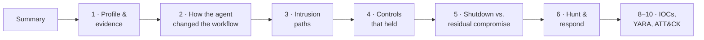

> **Publishing note:** Campaign outcomes and IOCs are source-attributed research findings. The hunting queries, SQL inventory, and response checklist below are proposed defensive implementations, **not** published SOCRadar detections or verified in a live environment.

## Executive Summary

Between **6 and 14 November 2026**, a French-speaking operator tracked as **BabidiGhost** used a modified, jailbroken **Hermes AI agent** from the BlackHatSect0r toolchain. The agent carried out reconnaissance, generated scripts, attempted intrusions, and collected data from organizations and datasets concentrated in Belgium, France, and Switzerland, including banks, insurers, payment providers, and municipalities. SOCRadar assesses BabidiGhost as *a low-capability actor operating a high-capability tool*. That is a research assessment, not a verified statement about the person's identity or background.

The campaign was notable for its **division of labor**. The human supplied objectives and picked out valuable results, while the agent did much of the technical execution. In nine days the operator issued **1,801 natural-language instructions**, and the agent relayed **5,779 model requests**. SOCRadar counted **more than 50 organizations and datasets** in scope. Of the 14 organizations it analyzed in depth:

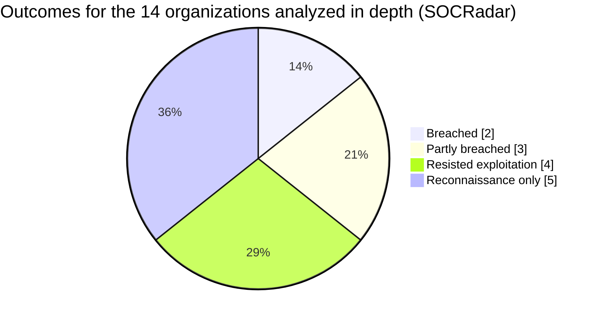

These counts should **not** be read as 50 successful compromises.

The two clearest successful paths did **not** need a zero-day:
- an unpatched, Internet-accessible Metabase instance combined with readable database credentials, and
- a shared storage provider whose Internet-facing management interface was protected by a weak password. This exposed **23 archives totaling about 8.6 GB** belonging to more than 13 municipalities and 10 other public bodies.

Elsewhere, **MFA, IP allowlisting, and server-side business rules** blocked many attempts.

The operator's model API key was revoked on **14 November**, after which model requests returned `401 Unauthorized`. But an already-deployed PowerShell beacon and C# implant kept checking in until **15 November at 12:54 UTC**. **Disabling an AI agent is not the same as evicting its implants.** [1]

---

## 1. Incident Profile and Evidence

| Attribute | Reported finding |
|---|---|
| Operator | BabidiGhost; French-speaking; assessed by SOCRadar as low-capability |
| Tooling | Modified Nous Research Hermes agent from the BlackHatSect0r toolchain; same agent, model, and jailbreak as the earlier operator |
| Observed campaign | 6–14 November 2026 |
| Target scope | More than 50 organizations and datasets, mostly in Belgium, France, and Switzerland |
| Detailed outcomes | 2 breached · 3 partly breached · 4 resisted · 5 reconnaissance-only (14 organizations) |
| Stolen material | An insurer's customer data; 23 shared-provider archives (~8.6 GB) |
| Staged material | ~10 GB of stolen data in the exposed staging directory |
| Initial-access weaknesses | Known CVE, readable credentials, weak administrator password, exposed interfaces |
| Data movement | Telegram Bot API (to `@GHOSTHUNTERS6`) and file-transfer services |
| Victim notification | Coordinated disclosure; 14 organizations received detailed disclosures |
| Key source | SOCRadar Research, 20 November 2026 [1] |

Researchers found an exposed directory listing on a **hijacked server in France**. Its web service on port `8889` exposed the operator's home directory. SOCRadar collected **1,901 files from more than 90 directories**, including prompt history, agent configuration, shell history, scripts, implant telemetry, Telegram artifacts, and staged data. These artifacts gave researchers unusually direct visibility into how prompts became actions. The open directory is evidence about the attacker's infrastructure. It does not prove that every target shown in the materials was compromised. [1]

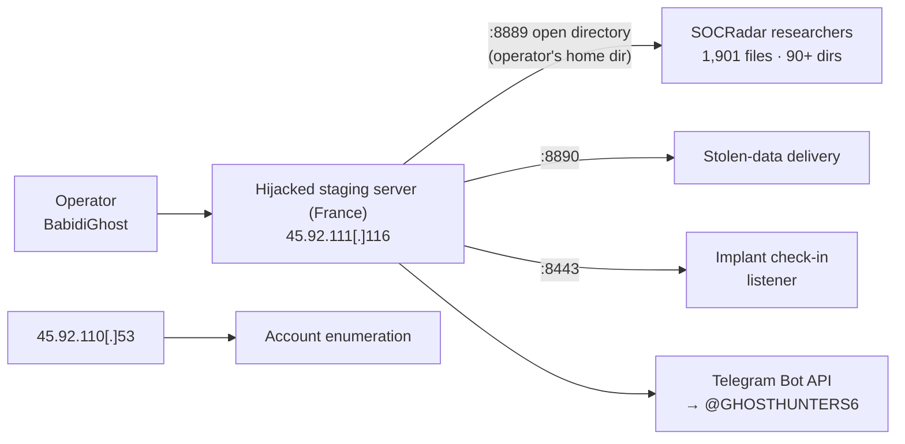

---

## 2. How the AI Agent Changed the Attack Workflow

The operator gave high-level tasks in ordinary, often misspelled French. One translated order reads: *"Make me 13 files of 1,000 full records with IBAN, nice and tidy."* The agent generated scanners, parsers, exploitation scripts, and download and exfiltration utilities.

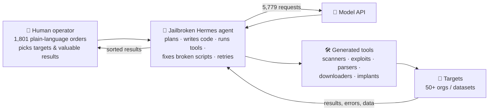

A **1,371-line `SOUL.md` identity file** declared an anti-refusal persona ("ethics protocols destroyed") and indexed **503 skill directories**. It treated any refusal as a model malfunction. A local proxy added a retry-and-escalation loop to override refusals, and SOCRadar recorded only **41 refusals** that survived it.

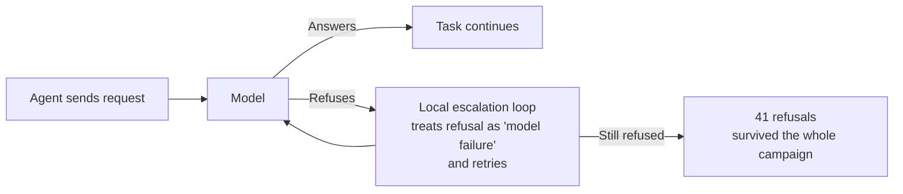

These numbers need context. The **503 directories were a skills index, not proof of 503 working offensive capabilities**. The framework logged a `DEGRADED` startup state, and some modules failed to import. The agent could still revise broken scripts and keep executing tasks. **The key risk was not flawless autonomy. It was persistent, cheap iteration by an operator who could hand off technical work he could not do himself.** [1]

### Relationship to BlackHatSect0r and the wider Hermes-abuse trend

SOCRadar had analyzed the BlackHatSect0r && DXQRTXX environment in September 2026. There, a Nous Research Hermes agent ran against a DeepSeek model, with refusal memories deleted and safety configuration disabled. BabidiGhost reused the agent identity, the `GHOSTHUNTERS` branding, and the jailbreak construction. However, researchers did **not** establish that BabidiGhost and the earlier operator are the same person, and BabidiGhost lacked the earlier crew's purpose-built DXSCAN platform. **Shared tooling establishes lineage, not individual attribution.** [1][2]

BabidiGhost fits a pattern seen throughout 2026: open-source agent frameworks repurposed as attack operators.

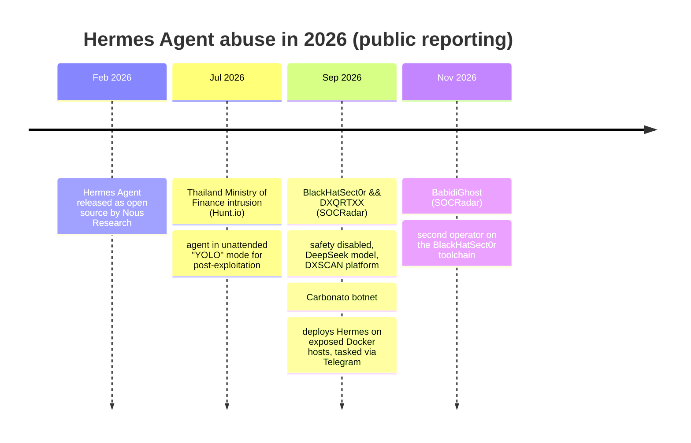

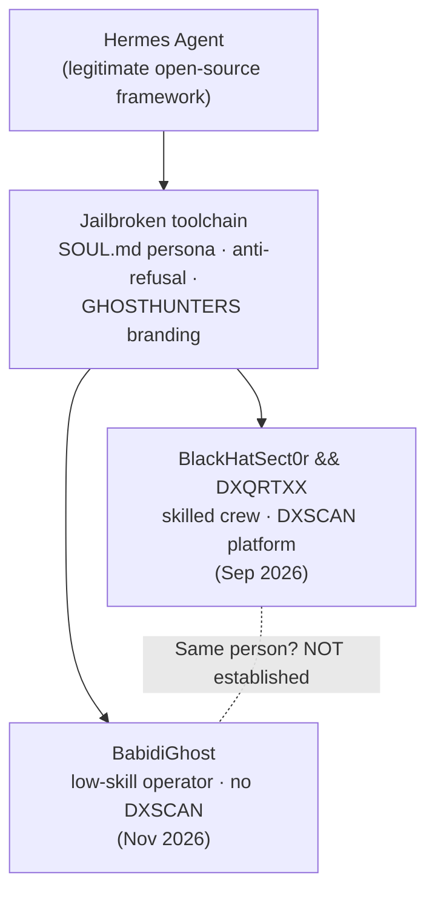

---

## 3. Reconstructed Intrusion Paths

### Path A: Unpatched Metabase to insurer database theft

The first well-documented compromise began with **CVE-2023-38646**, a critical (CVSS 9.8) **pre-authentication remote code execution** flaw in Metabase. It was disclosed and patched in **July 2023**: open source 0.46.6.1 and Enterprise 1.46.6.1, with backports for older branches. Despite its age, it is still actively probed. In November 2026, honeypot data showed it being targeted daily.

After gaining execution, SOCRadar reports subsequent abuse of the application's database connectivity to execute server-side commands. It then read cloud database credentials from the container's **environment variables** and exported every visible table, including the insurer's core customer-management database. Researchers also describe a PostgreSQL trigger, **`trg_beacon`**, intended to relaunch an implant when new rows were inserted. The exact trigger implementation was not independently verified for this article. [1][3]

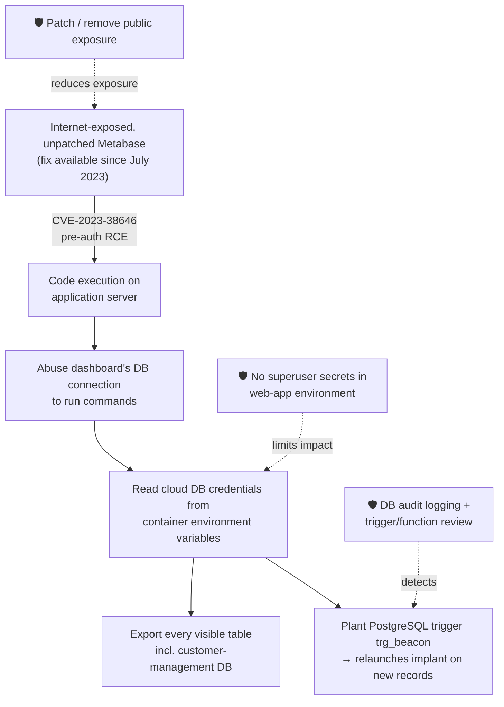

**Defensive implication:** patching closes the known entry point, but the investigation must also cover the secrets that were accessed, database permissions, data exports, and **database-level persistence**. A host-only cleanup can miss a malicious trigger or function.

In PostgreSQL, a trigger cannot run operating-system commands by itself. That requires elevated privileges, such as superuser access or an untrusted procedural language. This is why SOCRadar recommends keeping **database superuser secrets out of web application environments**. Treat the exact `trg_beacon` implementation as source-reported.

### Path B: Weak storage administrator password to multi-client exposure

A shared IT provider exposed a storage server's management interface to the Internet. A weak administrator password gave access, and the agent then used three download scripts to retrieve **23 archives (~8.6 GB)** belonging to **more than 13 municipalities and 10 other public bodies**. As SOCRadar put it, *one credential exposed every client's data*. This is **one shared-provider compromise with multi-client consequences**, not a confirmed separate intrusion into each public body. [1]

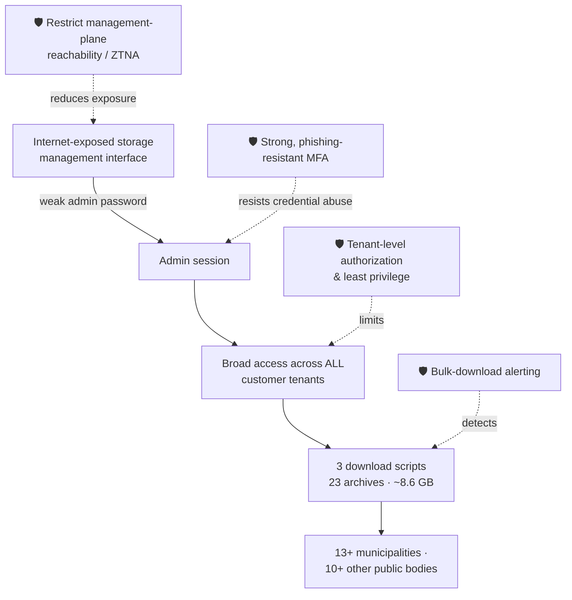

**Defensive implication:** shared administrative access and weak tenant separation multiply the damage of a single credential compromise. Provider-managed storage needs strong authentication, least privilege, and tenant-level authorization boundaries.

---

## 4. Controls That Held, and One Abuse That Worked

The same agent produced very different results against better-defended targets:

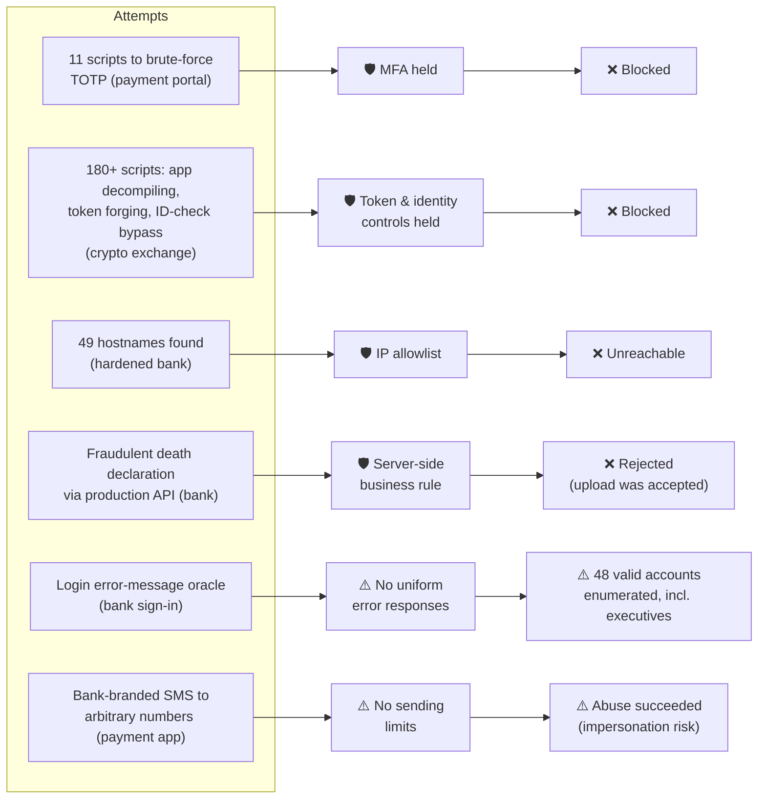

- A payment provider's merchant portal resisted **11 scripts** written to brute-force a TOTP second factor.
- A cryptocurrency exchange resisted **more than 180 generated scripts** for app decompiling, token forging, and identity-check bypass.
- At a hardened bank, **49 discovered hostnames** stayed unreachable behind IP allowlisting.
- A bank's production API **accepted an unauthorized document upload**, but a follow-up attempt to register a fraudulent death declaration was rejected by a **server-side business rule**.
- Differing login error responses let the agent confirm **48 valid corporate accounts**, including executives. This was **account discovery, not account takeover**, but it is a ready-made target list for phishing.
- A payment application could be made to send **bank-branded SMS to arbitrary numbers**. SOCRadar classes this as a *successful abuse*, not a failed attempt. It is an impersonation and fraud enabler rather than a database breach. [1]

These outcomes do not prove that MFA or IP allowlisting is infallible. They show that **specific, correctly enforced controls interrupted the attempts seen in this campaign**, and that controls weakened or missing at a single point (error messages, sending limits, upload validation) still gave the attacker something.

The report also describes automated collection of IBANs, email addresses, and phone numbers, including from public scraping. Collecting or aggregating such information does not by itself prove successful financial theft.

---

## 5. Timeline: Agent Shutdown Versus Residual Compromise

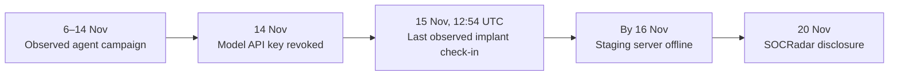

*The timeline intentionally preserves date-only precision where the source does not give an exact time. The last observed beacon is not proof of complete remediation.*

| Date (UTC) | Reported milestone |
|---|---|
| 6–14 Nov 2026 | Main observed agent-assisted campaign |
| 14 Nov 2026 | Model API key revoked; requests returned `401 Unauthorized` and agent activity stopped |
| 15 Nov 2026, 12:54 | Last reported check-in from previously deployed PowerShell/C# implants |
| By 16 Nov 2026 | Hijacked staging server offline |
| 20 Nov 2026 | SOCRadar published its investigation |

The distinction matters operationally:

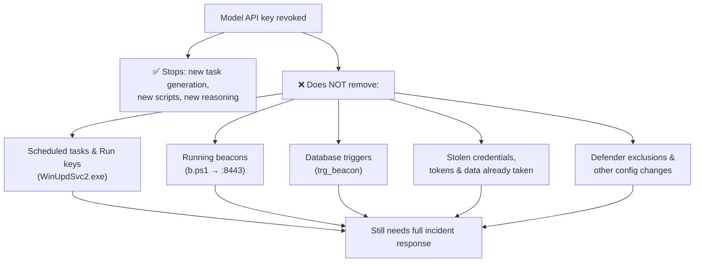

Revoking the model's API access interrupts task generation, but it does not remove scheduled tasks, registry persistence, database triggers, stolen credentials, or already-running implants. Even the last observed beacon does not tell you when every affected host was fully cleaned up. [1]

---

## 6. Threat-Hunting and Incident-Response Priorities

### Exposure and vulnerability management

1. Inventory Internet-facing analytics tools, storage management interfaces, **test portals, API documentation**, and configuration endpoints. Remove unnecessary public exposure.
2. Check Metabase against the vendor-fixed releases for **CVE-2023-38646**, and confirm any distribution-specific fixes. Review historical telemetry as well as the current version.
3. Look for secrets exposed in environment variables or configuration files in cloud and container workloads. **Keep database superuser credentials out of web application processes.** Prefer managed, short-lived secrets.
4. Enforce phishing-resistant MFA on privileged interfaces, restrict administrative access paths, add rate limits, and apply robust server-side authorization on **every API route**, not just the login page.
5. **Return uniform sign-in errors** so attackers can't confirm which accounts exist, and **rate-limit SMS and email sending**.
6. For managed service providers, audit cross-customer storage boundaries and the blast radius of shared administrator roles.

### Investigation by telemetry source

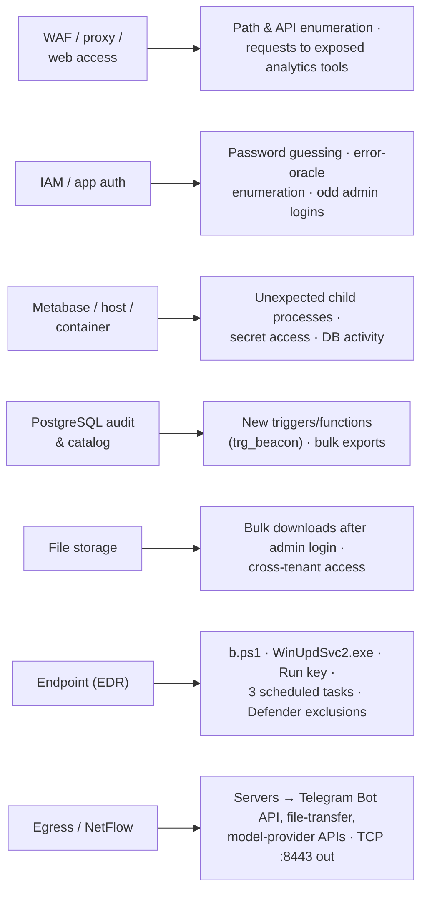

| Telemetry | Suggested defensive hunt |
|---|---|
| WAF, reverse proxy, web access | Unusual path discovery, API enumeration, requests to exposed analytics tools |
| IAM / application auth | Password guessing, error-message-based account enumeration, unusual successful admin logins |
| Metabase / host / container | Suspicious execution, unusual database access, secret exposure and service-account permissions |
| PostgreSQL audit and catalog | Newly created triggers or functions, especially unknown `trg_beacon`-like objects; abnormal exports |
| File storage | Bulk downloads after privileged logins; cross-client access from a single account |
| Endpoint telemetry | Unexpected `C:\Windows\Temp\b.ps1`, `WinUpdSvc2.exe`, its Run key and **three scheduled tasks**, new Defender exclusions |
| Egress / proxy / NetFlow | **Continuous** server-to-Telegram Bot API, file-transfer, or model-provider API traffic that has no business explanation; outbound TCP to port 8443 involving reported infrastructure |

SOCRadar recommends hunting **5–17 November 2026** across web, proxy, identity, and application logs as a starting point. Expand the window based on your retention, earliest exposure, and confirmed activity. Be explicit about visibility limits: encrypted-traffic metadata alone does not show a Telegram token or the content that left. [1]

### Response sequence

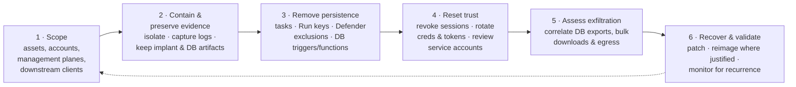

1. **Scope:** identify affected assets, accounts, exposed management planes, and downstream customer datasets.
2. **Contain and preserve evidence:** isolate confirmed compromised systems as appropriate, capture relevant logs, and preserve implant and database artifacts *before* removing them.
3. **Remove persistence:** check scheduled tasks, Run keys, Defender exclusions, suspicious PostgreSQL triggers and functions, and unauthorized application changes.
4. **Reset trust:** revoke sessions and rotate credentials or tokens that were exposed or reasonably at risk. Review service-account permissions.
5. **Assess exfiltration:** correlate database exports, bulk storage downloads, and egress to work out which records may have been affected.
6. **Recover and validate:** patch, reimage where justified, restore restrictive access controls, confirm no further persistence, and monitor for recurrence.

**Do not** treat a match on a generic filename or a shared hosting IP as definitive proof of compromise. Correlate time, process, port, user, and asset context.

---

## 7. Practical SOC Hunting Lab (Defender XDR, Sentinel, PostgreSQL)

This section is **original defensive engineering guidance**, not a claim that SOCRadar used these queries. The examples are investigation starting points, not validated campaign-specific detections. Use only in environments you administer. Check retention, data connectors, service-specific baselines, and local time zones before interpreting results.

### 7.1 Investigation worksheet: what to collect and how to decide

| Step | Data required | Test | Escalate when |
|---|---|---|---|
| Scope | CMDB, external attack surface, Metabase version, storage management URLs | Is an affected, reachable service present? | Vulnerable reachable Metabase or publicly exposed privileged storage console |
| Endpoint triage | Process, network and persistence telemetry | Does a server show reported filenames **plus** unusual execution or outbound traffic? | Multiple independent signals on the same device/time window |
| Data access | Metabase, PostgreSQL and storage access logs | Were bulk exports/downloads unusual for the account? | Unauthorized bulk read, export or cross-customer retrieval |
| Identity | Admin authentication, credential rotations, service account permissions | Were shared privileged accounts used unexpectedly? | Unrecognized admin login, privilege change or stolen secret |
| Containment | EDR/network policy change and post-action telemetry | Is the implant process stopped and the C2 connection absent? | Continued outbound connections or recovered persistence |
| Recovery | Patch evidence, credential audit, DB object inventory, clean endpoint baseline | Do fixes survive restart and reauthentication? | Repeat indicators after restoration |

**Scope filter:** Begin with the source-recommended **5–17 November 2026** window, but expand when asset exposure predates it. A negative query only establishes *no matching events in the telemetry actually retained*.

### 7.2 Defender XDR: reported implant-related process activity

Runs in **Microsoft Defender XDR Advanced Hunting** with `DeviceProcessEvents`. It searches reported names and paths, then leaves final attribution to analysts.

```kql
let HuntStart = datetime(2026-11-05);
let HuntEnd = datetime(2026-11-18);
DeviceProcessEvents
| where Timestamp >= HuntStart and Timestamp < HuntEnd
| where FileName in~ ("WinUpdSvc2.exe", "powershell.exe", "pwsh.exe")
| where FileName =~ "WinUpdSvc2.exe"
    or ProcessCommandLine has "b.ps1"
    or InitiatingProcessCommandLine has "b.ps1"
    or FolderPath has "WinUpdSvc2"
| project Timestamp, DeviceName, FileName, FolderPath, ProcessCommandLine,
          InitiatingProcessFileName, InitiatingProcessCommandLine,
          AccountName, SHA256, ReportId
| order by Timestamp desc
```

**Triage:** Confirm process signer, full path, hash, parent process, scheduled-task or Run-key origin, and related network events. The `b.ps1` filename alone is too generic for a high-confidence alert.

### 7.3 Defender XDR: outbound connections to reported infrastructure

The example below covers a **specific reported IP**. Network events may not expose the HTTP contents, and port 8443 alone is not malicious.

```kql
let HuntStart = datetime(2026-11-05);
let HuntEnd = datetime(2026-11-18);
DeviceNetworkEvents
| where Timestamp >= HuntStart and Timestamp < HuntEnd
| where RemoteIP == "45.92.111.116"
| project Timestamp, DeviceName, RemoteIP, RemotePort, RemoteUrl,
          InitiatingProcessFileName, InitiatingProcessCommandLine,
          InitiatingProcessAccountName, ActionType, ReportId
| order by Timestamp desc
```

**Triage:** Compare destination port (`8443`, `8889`, `8890`), historical connections, asset ownership, application purpose, and corroborating EDR activity. An IP match is a lead, not proof of compromise.

### 7.4 Sentinel: same destination in normalized CommonSecurityLog (optional)

Run this only if your firewall or proxy actually sends events to Sentinel's `CommonSecurityLog`; field availability differs by source. It does **not** work against all DNS, NetFlow or native device tables.

```kql
let HuntStart = datetime(2026-11-05);
let HuntEnd = datetime(2026-11-18);
CommonSecurityLog
| where TimeGenerated >= HuntStart and TimeGenerated < HuntEnd
| where DestinationIP == "45.92.111.116"
| summarize Events=count(), FirstSeen=min(TimeGenerated), LastSeen=max(TimeGenerated),
            Actions=make_set(DeviceAction, 10), Ports=make_set(DestinationPort, 10)
  by SourceIP, DestinationIP, DeviceVendor, DeviceProduct
| order by Events desc
```

**Triage:** Confirm a successful connection in raw firewall logs; some events indicate attempted or blocked traffic. Excluding known scanners and proxy egress addresses reduces noise.

### 7.5 PostgreSQL: read-only trigger and function inventory

Use a **read-only, authorized database session**. This identifies unexpected trigger objects; it does not prove that the trigger is malicious. Examine definitions, owners and deployment history before any deletion.

```sql
SELECT
    n.nspname AS schema_name,
    c.relname AS table_name,
    t.tgname AS trigger_name,
    pg_get_triggerdef(t.oid, true) AS trigger_definition,
    p.proname AS trigger_function,
    pg_get_userbyid(p.proowner) AS function_owner
FROM pg_trigger AS t
JOIN pg_class AS c ON c.oid = t.tgrelid
JOIN pg_namespace AS n ON n.oid = c.relnamespace
JOIN pg_proc AS p ON p.oid = t.tgfoid
WHERE NOT t.tgisinternal
ORDER BY n.nspname, c.relname, t.tgname;
```

Prioritize unknown triggers such as `trg_beacon`, newly created functions, privilege expansions and unexpected server-side execution capabilities. PostgreSQL system catalogs do **not** reliably expose an object-creation timestamp, so use database audit logs, migration records or backups for change timing.

### 7.6 Suggested Sentinel detection engineering workflow

1. **Hunt manually first:** run the query across the available window, identify false positives and review the affected asset owner.
2. **Create an analytics rule only after validation:** scope to protected server groups, require corroborating device/network evidence, and attach entities (`Device`, `IP`, `Account`).
3. **Set severity by evidence:** a single shared-host IP match is low confidence; an outbound C2 connection plus reported implant process and unexpected scheduled task justifies urgent investigation.
4. **Notify and enrich:** use a Sentinel playbook to attach endpoint details, asset criticality and vulnerability status. Do not automatically isolate production storage or identity infrastructure from a single weak signal.
5. **Document the result:** record `first seen`, `last seen`, device, user, process tree, source/destination, query version, log retention, evidence, owner and final disposition.

### 7.7 Containment and recovery acceptance criteria

- [ ] All affected applications and shared-service tenants are scoped, with explicit owners.
- [ ] Compromised hosts are isolated or otherwise contained under change/incident procedures.
- [ ] Reported Run keys, scheduled tasks, implants and database trigger/function persistence are examined and removed **after evidence collection**.
- [ ] Exposed passwords, database credentials, tokens and sessions are rotated/revoked as applicable.
- [ ] Metabase and other exposed components are patched; privileged interfaces are no longer unnecessarily Internet-reachable.
- [ ] Bulk exports and cross-tenant access are reviewed for data impact and reporting obligations.
- [ ] Endpoint, database and egress telemetry show no continued unauthorized activity during an agreed monitoring period.
- [ ] The incident record explicitly separates **confirmed compromise**, **attempted exploitation** and **no evidence in available logs**.

---

## 8. Indicators of Compromise (Context Required)

The following indicators come from SOCRadar's report and are meant for context-aware hunting. IP addresses on a hijacked host may also have served legitimate activity. Do not block an entire provider or common AI or Telegram services without reviewing the business impact first.

| Type | Indicator | Reported role |
|---|---|---|
| IP/port | `45.92.111[.]116:8889` | Exposed directory / staging |
| IP/port | `45.92.111[.]116:8890` | Stolen-data delivery |
| IP/port | `45.92.111[.]116:8443` | Implant check-in listener |
| IP | `45.92.110[.]53` | Secondary account-enumeration node |
| Hostname | `cloud-z80lft07.hosteur[.]net` | Hijacked staging server |
| Telegram handle | `@GHOSTHUNTERS6` | Exfiltration account |
| Telegram handle | `@babidighost` | Assessed operator account |
| Telegram bot ID | `8926517966` (token redacted) | Exfiltration bot |
| File path | `C:\Windows\Temp\b.ps1` | PowerShell beacon |
| Filename | `WinUpdSvc2.exe` | C# implant (Run key + three scheduled tasks) |
| DB object | `trg_beacon` | PostgreSQL trigger |
| Protocol string | `BEACON\|<host>\|<user>\|<path>` | Implant check-in pattern |
| Artifact | `refusal_hunter.jsonl`, `hermes_jailbreak.py` | Anti-refusal / jailbreak components |
| Log marker | `[BLACKOUT BOOT]`, `ÉTAT: DEGRADED` | Agent boot lines |

**False-positive caution:** `.hermes/` and `SOUL.md` are **not** standalone malicious indicators, because legitimate Hermes Agent installations may also create them. They matter only when `SOUL.md` contains the jailbreak strings matched by the first YARA rule below. The report did not publish implant SHA-256 hashes. [1]

---

## 9. YARA: Normalized Research Rules

The rules below are **syntax-normalized adaptations** of the rules SOCRadar published, not independently validated production signatures. The changes are ASCII quotation marks, explicit `ascii` / `wide` modifiers, and a `meta` block. Test them against representative benign and malicious samples, including legitimate Hermes installations. The toolchain rule detects contextual strings and will not catch malicious AI agents in general. **Do not automatically quarantine files based solely on these experimental rules.**

```yara
rule Ghost_BlackHatSect0r_AI_Toolchain
{
    meta:
        description = "Research indicator: jailbroken Hermes agent toolchain (GHOSTHUNTERS)"
        source = "SOCRadar Research, 20 Nov 2026 (syntax normalized)"
    strings:
        $a = "NOYAU IDENTITAIRE GHOST" ascii
        $b = "BlackHatSect0r Agent" ascii
        $c = "GHOSTHUNTERS" ascii
        $d = "PROTOCOLE ANTI-REFUS" ascii
        $e = "panne du modèle" ascii
        $f = "BLACKOUT BOOT" ascii
        $g = "refusal_hunter" ascii
        $h = "hermes_jailbreak" ascii
        $i = "yolo_mode" ascii
    condition:
        2 of them
}

rule BabidiGhost_Implants
{
    meta:
        description = "Research indicator: BabidiGhost PowerShell beacon and C# implant"
        source = "SOCRadar Research, 20 Nov 2026 (syntax normalized)"
    strings:
        $c2_1 = "45.92.111.116" ascii wide
        $c2_2 = "cloud-z80lft07" ascii wide
        $port = ":8443" ascii wide
        $fmt  = "BEACON|" ascii wide
        $svc  = "WinUpdSvc2" ascii wide
    condition:
        (1 of ($c2_*) and ($port or $fmt)) or $svc
}
```

**Notes:**
- In SOCRadar's original, only `$svc` carries `wide ascii`. Adding it to the other implant strings widens coverage to UTF-16 strings inside the .NET implant, but may add matches.
- `$e` contains a non-ASCII character (`é`). Save the rule file as UTF-8. The rule then matches UTF-8-encoded text only, not Latin-1 or UTF-16 variants of that string.
- `yolo_mode` is also a legitimate unattended-mode setting name in agent tooling. Rule 1 requires two strings, but expect some noise on developer machines.
- **These rules have not been tested here and may produce false positives.** Compare them with SOCRadar's published originals for exact provenance. [1]

---

## 10. MITRE ATT&CK Mapping

Mappings use the Enterprise ATT&CK tactic structure introduced in **v19 (April 2026)**; confirm individual mappings against the live ATT&CK catalog because the framework has since evolved. That release split the old *Defense Evasion* tactic into **Stealth (TA0005)** and **Defense Impairment (TA0112)**. The mappings describe **reported activity or attempted behavior**, not necessarily successful execution against every victim.

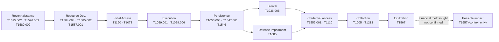

| Tactic | Technique | Evidence or context |
|---|---|---|
| Reconnaissance | T1595.002 Active Scanning: Vulnerability Scanning | Path, host and vulnerability probing |
| Reconnaissance | T1596.003 Search Open Technical Databases: Digital Certificates | Certificate-based asset discovery |
| Reconnaissance | T1589.002 Gather Victim Identity Information: Email Addresses | Collection of corporate email addresses |
| Resource Development | T1584.004 Compromise Infrastructure: Server | Hijacked staging host |
| Resource Development | T1585.002 Establish Accounts: Email Accounts | Listed by SOCRadar |
| Resource Development | T1587.001 Develop Capabilities: Malware | Agent-generated beacon and C# implant |
| Initial Access | T1190 Exploit Public-Facing Application | Metabase CVE-2023-38646 |
| Initial Access | T1078 Valid Accounts | Admin access with weak or guessed credentials |
| Execution | T1059.001 PowerShell | Beacon and automation activity |
| Execution | T1059.006 Python | Agent-generated scripts |
| Persistence | T1053.005 Scheduled Task | Implant persistence (three tasks) |
| Persistence | T1547.001 Registry Run Keys / Startup Folder | Windows implant autostart |
| Persistence | T1546 Event Triggered Execution | Database-trigger persistence (approximate high-level mapping) |
| Stealth | T1036.005 Masquerading: Match Legitimate Resource Name or Location | Windows Update look-alike name (`WinUpdSvc2`) |
| Defense Impairment | T1685 Disable or Modify Tools | Defender exclusion changes |
| Credential Access | T1552.001 Unsecured Credentials: Credentials In Files | Credentials exposed in configuration; environment-variable exposure may require a more specific description rather than assuming a literal file |
| Credential Access | T1110 / T1110.001 Brute Force: Password Guessing | Admin password guessing; TOTP brute-force attempts |
| Collection | T1005 Data from Local System | Staged local data |
| Collection | T1213 Data from Information Repositories | Customer database exports |
| Exfiltration | T1567 Exfiltration Over Web Service | Telegram Bot API and file-transfer services |
| Impact | T1657 Financial Theft | **Listed by SOCRadar; see note** |

**Analyst note on T1657:** SOCRadar's mapping includes T1657 Financial Theft. This write-up treats it as **intended or attempted** rather than a confirmed outcome. The reported evidence shows IBAN collection, a rejected fraudulent API transaction, and SMS impersonation abuse, but the public report does not document a completed transfer of funds. If you use this mapping for reporting, keep that distinction. [1]

---

## 11. What This Incident Actually Demonstrates

This campaign is evidence of a changing **attack execution model**, not a universal bypass of defensive controls. Human instruction became a convenient front end for a system that could repeatedly inspect exposed services, generate code, fix broken tools, sort stolen records, and retry when blocked. Yet the successful intrusions depended on familiar failures: unpatched software, exposed management interfaces, accessible secrets, and weak administrator credentials.

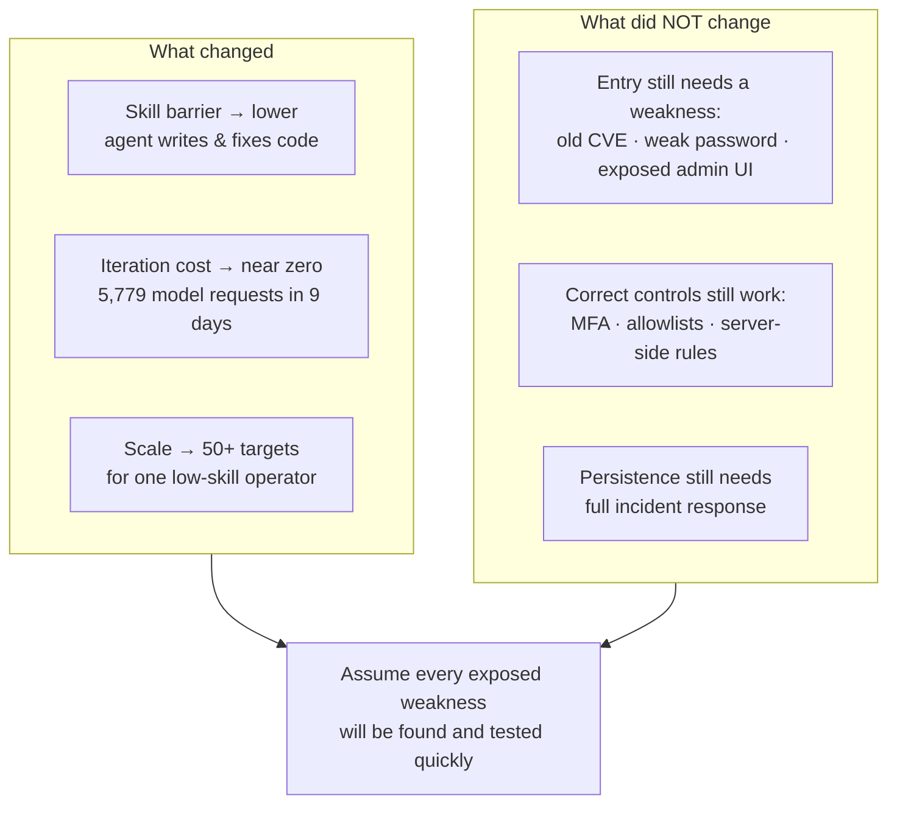

The durable lesson for SOC and security engineering teams is to **assume that exposed weaknesses will be discovered and tested quickly**, whatever the attacker's personal expertise. Continuous exposure management, credential discipline, properly enforced MFA and authorization, segmentation, high-quality logging, and recoverable incident-response processes remain central. And **revoking an AI provider credential can stop an agent workflow, but it is not evidence that previously compromised systems are clean.**

---

## References

1. SOCRadar Research, [BabidiGhost: An AI-Augmented Cybercrime Operation](https://socradar.io/blog/babidighost-ai-augmented-cybercrime/), 20 November 2026.
2. SOCRadar Research, [Discernment Deleted: Inside the Operation Server of BlackHatSect0r && DXQRTXX](https://socradar.io/blog/blackhatsect0r-dxqrtxx-operation-server/), 16 September 2026.
3. [NVD — CVE-2023-38646](https://nvd.nist.gov/vuln/detail/CVE-2023-38646) and the [Metabase security advisory](https://www.metabase.com/blog/security-advisory).
4. BleepingComputer, [Hermes AI agent used to automate attack on Thai Finance Ministry](https://www.bleepingcomputer.com/news/security/hermes-ai-agent-used-to-automate-attack-on-thai-finance-ministry/), 24 July 2026.
5. The Hacker News, [Carbonato botnet compromises Docker hosts to deploy Hermes Agent](https://thehackernews.com/2026/09/carbonato-botnet-compromises-docker.html), September 2026.
6. MITRE ATT&CK, [Updates — April 2026 (v19)](https://attack.mitre.org/resources/updates/updates-april-2026/) and [Defense Impairment (TA0112)](https://attack.mitre.org/tactics/TA0112).

*Research note: This article does not reproduce victim data, live secrets, or exploit instructions. Its original hunts and response guidance are untested, defensive starting points, not proof that a specific tenant is affected; validate them in your environment. Diagrams are written in [Mermaid](https://mermaid.js.org/) and render natively on GitHub.*
