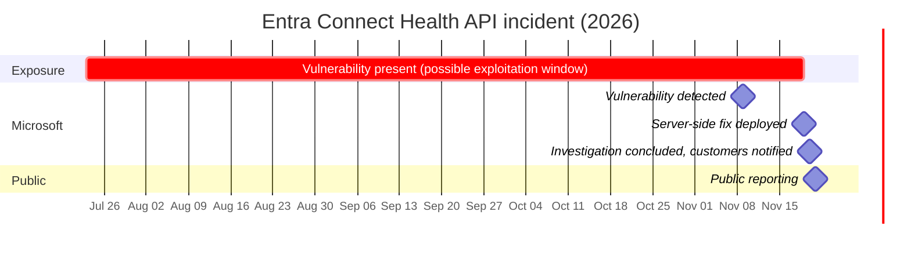
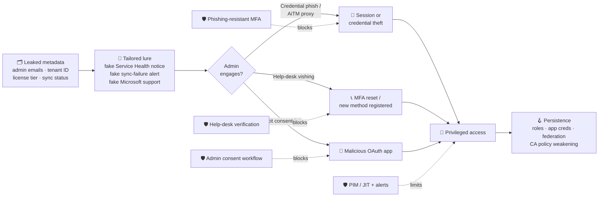
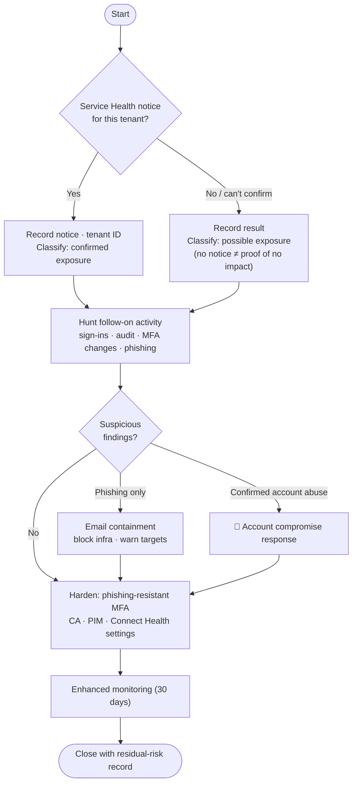
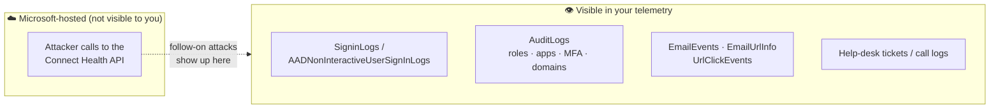
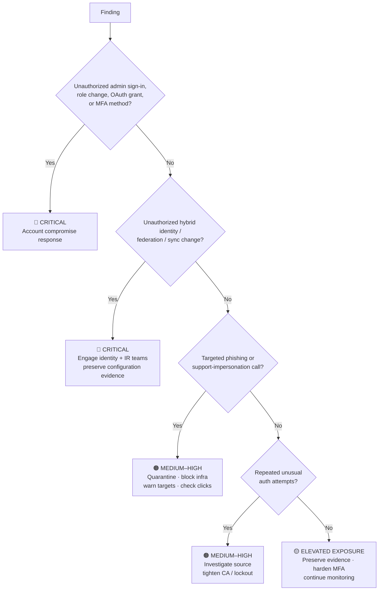
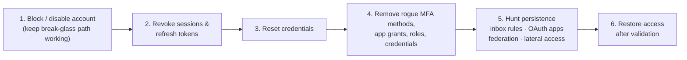
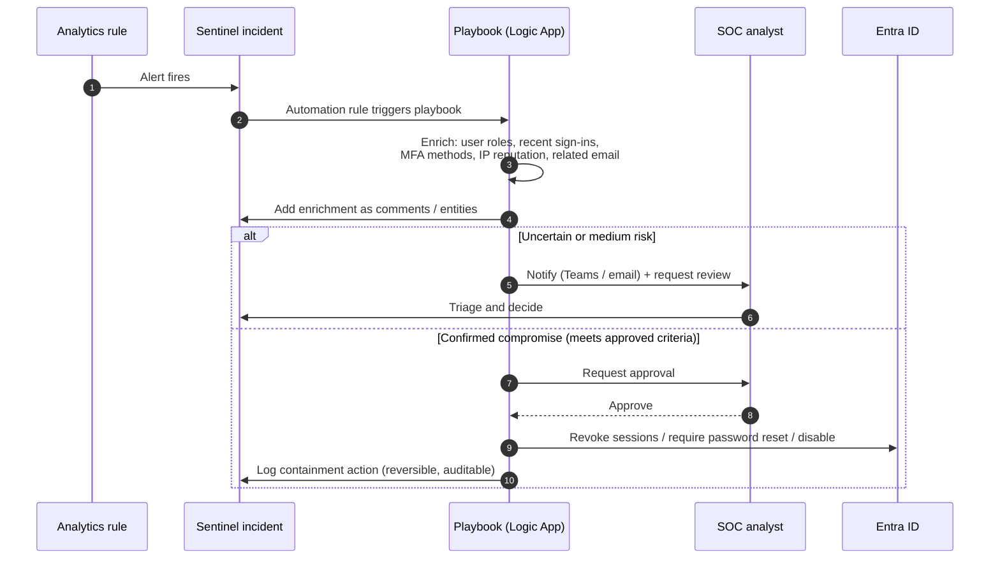
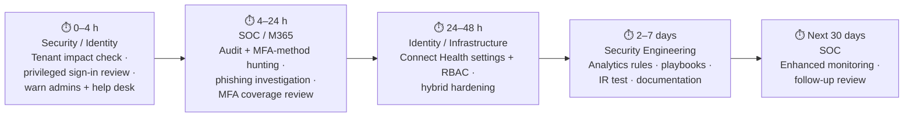

# Security Incident Response Playbook
## Microsoft Entra Connect Health API: Tenant Metadata Exposure (November 2026)


| Field | Value |
|---|---|
| **Playbook ID** | IR-ENTRA-2026-11-21 |
| **Version** | 1.2 (see [Change log](#change-log)) |
| **Environment** | Microsoft Entra ID, Entra Connect / Connect Health, Microsoft Sentinel, Defender XDR, Microsoft 365 |
| **Incident type** | Cloud service vulnerability · tenant metadata disclosure · potential targeted identity attacks |
| **Date** | November 21, 2026 |
| **Customer patch required** | **No.** Microsoft fixed it server-side. |

> **TL;DR:** Microsoft fixed the bug on its side. The risk that remains for customers is **targeted phishing and social engineering against the administrators whose contact details leaked**. Verify whether your tenant was notified, hunt for follow-on identity abuse, and harden privileged accounts. Don't tear down hybrid identity infrastructure without evidence of compromise.

---

## Table of Contents

- [1. Executive threat assessment](#1-executive-threat-assessment)
- [2. Response workflow at a glance](#2-response-workflow-at-a-glance)
- [3. Immediate response checklist](#3-immediate-response-checklist)
- [4. Investigation and threat hunting](#4-investigation-and-threat-hunting)
- [5. Containment decision playbook](#5-containment-decision-playbook)
- [6. Preventive hardening](#6-preventive-hardening)
- [7. Detection engineering and automated response](#7-detection-engineering-and-automated-response)
- [8. Recommended execution timeline](#8-recommended-execution-timeline)
- [9. Closure criteria](#9-closure-criteria)
- [10. Internal security advisory template](#10-internal-security-advisory-template)
- [11. Prioritization guidance and limitations](#11-prioritization-guidance-and-limitations)
- [References](#references)

---

## 1. Executive threat assessment

Microsoft has confirmed that unauthorized parties exploited a vulnerability in the **Entra Connect Health cloud API**. They gained read-only access to tenant-level metadata, including administrator and technical-contact email addresses.

### 1.1 Incident timeline



| Date (2026) | Event |
|---|---|
| **July 23** | Vulnerability introduced into the Connect Health API. This is the earliest possible start of exploitation; Microsoft hasn't said when abuse actually began. |
| **November 9** | Microsoft detected the vulnerability |
| **November 19** | Server-side fix deployed |
| **November 20** | Investigation concluded; affected customers notified through Azure Service Health and directly to admins |
| **November 21** | Public reporting (BleepingComputer) |

The vulnerable window ran for roughly **119 days**, 109 of them before detection.

### 1.2 Status at a glance

| Item | Status |
|---|---|
| 🛠️ Vulnerability | **Fixed server-side**, November 19, 2026 |
| 📦 Customer patch | **None required**. Connect Health agents update automatically. |
| 🔎 Confirmed access | **Read-only tenant metadata** |
| ✏️ Configuration changes | The flaw *could* have allowed changes to Connect Health monitoring settings, but Microsoft **reported no unauthorized changes** |
| 🎯 Primary follow-on risk | **Targeted phishing and social engineering**, especially against privileged accounts |
| 🏷️ CVE | None published for this issue at time of writing |
| 👤 Attribution / scale | Not disclosed (no attacker named, no tenant count, no exploitation start date) |

### 1.3 Information potentially exposed

| Exposed data | Security implication |
|---|---|
| Administrator and technical-contact email addresses | Targeted phishing, vishing, and Microsoft-support impersonation |
| Tenant ID, display name, initial domain, country and region | Tenant-specific reconnaissance and convincing lures |
| Entra license tiers | Guessing which identity protections (P1/P2, PIM, ID Protection) are present |
| Directory sync status and last-sync timestamp | Knowledge of hybrid identity configuration; believable "sync failure" lures |
| Connect Health onboarding status | Reconnaissance of monitoring coverage |
| Expired agent-registration certificate | Historical only. It was used with an internal Microsoft service decommissioned in late 2024 and is no longer valid. |

**Not exposed (per Microsoft):** passwords or password hashes, authentication tokens, valid cryptographic keys, on-premises network/AD topology, and Azure subscription data.

### 1.4 Threat model: how leaked metadata becomes an attack



> ⚠️ **The notification itself is a lure.** Microsoft notified admins by email as well as through Service Health, so attackers have a ready-made template. Admins should verify any "Connect Health security notice" by **signing in to the Azure portal directly**, never through links in an email.

### 1.5 Risk determination

This incident is primarily an **identity reconnaissance and targeted social-engineering risk**. It is not evidence of tenant takeover.

For hybrid identity organizations, the leaked data helps an attacker write convincing messages to administrators, impersonate Microsoft support, or go after the accounts responsible for Entra Connect.

> 🚫 **Don't** automatically rotate every credential, disconnect Entra Connect, or shut down directory synchronization. The evidence available doesn't justify those disruptive actions unless you find additional indicators of compromise.

---

## 2. Response workflow at a glance



---

## 3. Immediate response checklist

| Priority | Task | Owner |
|:---:|---|---|
| **P0** | Check **Azure Service Health → Security advisories** for a notice naming the tenant | Identity / SecOps |
| **P0** | Confirm whether Entra Connect Health is deployed; inventory associated servers and agents | Identity |
| **P0** | Review privileged users' interactive and non-interactive sign-ins | SOC |
| **P0** | Review Entra audit logs for unexpected role, app, credential, MFA-method and policy changes | SOC / Identity |
| **P0** | Warn administrators **and the help desk** about targeted phishing and support-impersonation calls | Security |
| **P1** | Verify phishing-resistant MFA and Conditional Access coverage for privileged identities | Identity |
| **P1** | Hunt for targeted phishing and suspicious Microsoft-support impersonation | SOC / M365 |
| **P1** | Review Connect Health **notification settings** and **Azure RBAC roles**; check them against a known-good baseline | Identity |
| **P1** | Record findings, evidence, affected accounts, and residual risk | Incident lead |

**Tracker (copy into your ticket):**

- [ ] Service Health notification status recorded
- [ ] Connect Health deployment and agents inventoried
- [ ] Privileged sign-ins reviewed (interactive + non-interactive)
- [ ] Entra audit log reviewed
- [ ] Admins and help desk warned
- [ ] Phishing-resistant MFA / CA coverage verified
- [ ] Phishing hunt completed
- [ ] Connect Health notification settings and RBAC validated
- [ ] Findings and residual risk documented

> **What a notification does and doesn't mean:** it confirms that Microsoft identified the tenant as affected. It does **not** mean admin accounts were compromised. And **no notification** isn't definitive proof the tenant was unaffected.

---

## 4. Investigation and threat hunting

### 4.0 What you can and can't see



The original exploitation happened in Microsoft's API. Calls to the Connect Health tenant API aren't customer-visible in Entra audit logs, and ARM read operations don't appear in the Azure Activity Log. **Every hunt below therefore looks for follow-on abuse, not the exploit itself.**

**Hunting window:** start at **July 23, 2026** if retention allows. If retention is limited, prioritize the most recent 30 days, and especially the period after notifications went out on November 20, when lures that copy the notice are most likely.

### Step 1: Confirm exposure through official channels

**Owner:** Identity / Security Operations

1. Sign in **directly** to the [Azure portal](https://portal.azure.com/) → **Service Health → Security advisories**, and look for the Connect Health notice for each tenant you manage. MSPs may receive a separate notice per customer tenant.
2. In the [Microsoft Entra admin center](https://entra.microsoft.com/), open **Connect Health** and confirm:
   - whether Connect Health agents (sync, AD FS, AD DS) are installed, and on which servers
   - which administrators and custom addresses receive Connect Health notifications (including the **"All global administrators"** option)
   - who holds Connect Health **Owner / Contributor / Reader** roles
   - whether directory synchronization is healthy
3. Optionally run Microsoft's metadata inspection script ([aka.ms/ConnectHealth/scripts](https://aka.ms/ConnectHealth/scripts)). It shows the **types** of data that could have been exposed, using **current** values. It is **not** a forensic record of what the attacker accessed. Read the script before running it.

**Evidence to preserve:** the Service Health notice (screenshot + tracking ID), tenant ID, Connect Health configuration baseline, review timestamps, and analyst notes. Don't paste secrets into the ticket.

### Step 2: Build the privileged-account list

Every hunt below needs the list of exposed identities. That means privileged role holders **plus** any technical-contact addresses, which may be shared mailboxes or distribution lists.

<details>
<summary><b>KQL 0: Privileged accounts from IdentityInfo (Sentinel UEBA)</b></summary>

```kql
// Requires Sentinel UEBA (IdentityInfo table). Otherwise maintain the list manually.
let PrivilegedRoles = dynamic([
    "Global Administrator", "Privileged Role Administrator",
    "Privileged Authentication Administrator", "Hybrid Identity Administrator",
    "Security Administrator", "Conditional Access Administrator",
    "Application Administrator", "Cloud Application Administrator",
    "Authentication Administrator", "User Administrator",
    "Exchange Administrator", "Helpdesk Administrator"
]);
IdentityInfo
| where TimeGenerated > ago(14d)
| summarize arg_max(TimeGenerated, *) by AccountObjectId
| where AssignedRoles has_any (PrivilegedRoles)
| project AccountUPN, AccountDisplayName, AssignedRoles
| order by AccountUPN asc
```

</details>

In the queries below, replace the example `AdminUPNs` list with this output plus your technical-contact addresses. Include emergency-access (break-glass) accounts.

### Step 3: Hunt suspicious privileged sign-ins (Sentinel)

**Owner:** SOC / Identity · **Requires:** Entra ID sign-in and audit log connectors

#### KQL 1: Privileged sign-in review

```kql
let ReviewStart = datetime(2026-07-23);
let AdminUPNs = dynamic(["admin1@example.org", "admin2@example.org"]);
SigninLogs
| where TimeGenerated >= ReviewStart
| where UserPrincipalName in~ (AdminUPNs)
| extend SignInSuccess   = ResultType == "0",
         DeviceCompliant = tostring(DeviceDetail.isCompliant),
         DeviceManaged   = tostring(DeviceDetail.isManaged),
         OS              = tostring(DeviceDetail.operatingSystem),
         AuthDetails     = AuthenticationDetails
| project TimeGenerated, UserPrincipalName, IPAddress, Location, AppDisplayName,
          SignInSuccess, ResultType, ResultDescription,
          RiskLevelDuringSignIn, RiskLevelAggregated, RiskState,
          ConditionalAccessStatus, AuthenticationRequirement, AuthDetails,
          DeviceCompliant, DeviceManaged, OS, UserAgent, CorrelationId
| order by TimeGenerated desc
```

**Investigate:** successful sign-ins from unfamiliar IPs or countries, new unmanaged or noncompliant devices, unexpected apps, risky sign-ins, single-factor sign-ins, and `ConditionalAccessStatus == "notApplied"` for admins.

#### KQL 2: First-seen IP addresses for admins (baseline comparison)

```kql
let AdminUPNs = dynamic(["admin1@example.org", "admin2@example.org"]);
let Baseline = 90d;
let Recent   = 14d;
let KnownIPs = SigninLogs
    | where TimeGenerated between (ago(Baseline) .. ago(Recent))
    | where UserPrincipalName in~ (AdminUPNs) and ResultType == "0"
    | extend UPN = tolower(UserPrincipalName)
    | distinct UPN, IPAddress;
SigninLogs
| where TimeGenerated > ago(Recent)
| where UserPrincipalName in~ (AdminUPNs) and ResultType == "0"
| extend UPN = tolower(UserPrincipalName)
| join kind=leftanti KnownIPs on UPN, IPAddress
| summarize FirstSeen = min(TimeGenerated), LastSeen = max(TimeGenerated),
            SignIns = count(), Apps = make_set(AppDisplayName, 10),
            Locations = make_set(Location, 5)
            by UPN, IPAddress
| order by FirstSeen desc
```

A successful sign-in isn't malicious in itself. Compare against normal admin working patterns, VPN egress ranges, and approved remote-access paths.

#### KQL 3: Password spray touching admin accounts

```kql
let AdminUPNs = dynamic(["admin1@example.org", "admin2@example.org"]);
// 50126 = invalid username or password, 50053 = account locked (smart lockout)
SigninLogs
| where TimeGenerated > ago(30d)
| where ResultType in ("50126", "50053")
| summarize FailedAttempts   = count(),
            DistinctAccounts = dcount(UserPrincipalName),
            AdminTargets     = make_set_if(UserPrincipalName, UserPrincipalName in~ (AdminUPNs), 20),
            Apps             = make_set(AppDisplayName, 10),
            FirstSeen = min(TimeGenerated), LastSeen = max(TimeGenerated)
            by IPAddress
| extend AdminTargeted = array_length(AdminTargets) > 0
| where DistinctAccounts >= 10 or (AdminTargeted and FailedAttempts >= 5)
| order by AdminTargeted desc, DistinctAccounts desc
```

This is a triage query, not a definitive spray detection. It groups by source IP across the whole tenant, so it catches sprays that hit admins alongside other users. Tune the thresholds, and remember that low-and-slow sprays rotate IPs. **Follow up** by checking for any *successful* sign-in from the flagged IPs.

#### KQL 4: Non-interactive activity for admin accounts

A stolen session or refresh token produces activity outside interactive sign-ins.

```kql
let AdminUPNs = dynamic(["admin1@example.org", "admin2@example.org"]);
AADNonInteractiveUserSignInLogs
| where TimeGenerated > ago(30d)
| where UserPrincipalName in~ (AdminUPNs)
| summarize Events = count(), FirstSeen = min(TimeGenerated), LastSeen = max(TimeGenerated),
            Apps = make_set(AppDisplayName, 10), Resources = make_set(ResourceDisplayName, 10),
            Results = make_set(ResultType, 10), RiskLevels = make_set(RiskLevelAggregated, 10)
            by UserPrincipalName, IPAddress
| order by FirstSeen desc
```

Look for unfamiliar apps, IPs that never appear in interactive sign-ins, and sudden shifts in an account's normal pattern.

### Step 4: Check identity configuration changes

**Owner:** Identity Administrator / SOC

Focus on unexpected changes to:

- Global Administrator and other privileged role assignments (including PIM eligibility)
- App registrations, service-principal credentials, owners, and consent grants
- Conditional Access policies and authentication-methods settings
- **MFA methods registered on admin accounts**
- Federation, domains, and identity-provider settings
- Directory synchronization settings and sync service accounts

#### KQL 5: Sensitive Entra audit activity

```kql
let SensitiveOps = dynamic([
    "Add member to role", "Add eligible member to role",
    "Consent to application", "Add delegated permission grant",
    "Add app role assignment to service principal",
    "Add service principal credentials",
    "Update application – Certificates and secrets management",
    "Add owner to application", "Add owner to service principal",
    "Add conditional access policy", "Update conditional access policy",
    "Delete conditional access policy",
    "Set domain authentication", "Set federation settings on domain",
    "Add unverified domain", "Verify domain",
    "Set DirSyncEnabled flag"
]);
AuditLogs
| where TimeGenerated > ago(30d)
| where OperationName in~ (SensitiveOps)
   or OperationName has_any ("role", "consent", "credential", "federation",
                             "conditional access", "authentication method")
| extend ActorUPN = tostring(InitiatedBy.user.userPrincipalName),
         ActorApp = tostring(InitiatedBy.app.displayName),
         ActorIP  = tostring(InitiatedBy.user.ipAddress),
         Target   = tostring(TargetResources[0].displayName),
         TargetUPN = tostring(TargetResources[0].userPrincipalName)
| project TimeGenerated, OperationName, Category, Result, ActorUPN, ActorApp, ActorIP,
          Target, TargetUPN, TargetResources, CorrelationId
| order by TimeGenerated desc
```

Operation names vary over time and by feature. This curated list plus keyword fallback is a starting point; a full investigation should also review **all** audit events by or against sensitive principals in the relevant window.

#### KQL 6: New or changed MFA methods on admin accounts

Social engineering often ends with the attacker registering their own MFA method.

```kql
let AdminUPNs = dynamic(["admin1@example.org", "admin2@example.org"]);
AuditLogs
| where TimeGenerated > ago(30d)
| where LoggedByService == "Authentication Methods" or OperationName has "security info"
| extend TargetUPN = tostring(TargetResources[0].userPrincipalName),
         ActorUPN  = tostring(InitiatedBy.user.userPrincipalName),
         ActorIP   = tostring(InitiatedBy.user.ipAddress)
| where TargetUPN in~ (AdminUPNs) or ActorUPN in~ (AdminUPNs)
| project TimeGenerated, OperationName, Result, ResultReason, TargetUPN, ActorUPN, ActorIP
| order by TimeGenerated desc
```

Confirm each registration with the account owner through an out-of-band channel.

> 🚨 **Escalate immediately** if you confirm unexplained privileged role assignments, unauthorized app consent, new app or service-principal credentials, unknown MFA methods on admins, federation or domain changes, or Conditional Access weakening.

### Step 5: Hunt targeted phishing (Defender XDR)

The exposed admin addresses are likely targets for Microsoft-support impersonation, fake sync-failure alerts, fake copies of the Connect Health notice, and credential-harvesting links.

These queries run in **Defender XDR Advanced Hunting**, or in Sentinel if Defender XDR tables are streamed (use `TimeGenerated` instead of `Timestamp` there). They require **Defender for Office 365** telemetry; `UrlClickEvents` requires Safe Links.

#### KQL 7: Identity-themed email to admins

```kql
let AdminRecipients = dynamic(["admin1@example.org", "admin2@example.org"]);
EmailEvents
| where Timestamp > ago(30d)
| where RecipientEmailAddress in~ (AdminRecipients)
| where Subject has_any ("Entra", "Azure AD", "Connect Health", "directory synchronization",
                         "sync", "Service Health", "security advisory", "security notification",
                         "tenant", "administrator verification", "Microsoft support", "action required")
| join kind=leftouter (
    EmailUrlInfo
    | summarize Urls = make_set(Url, 10), UrlDomains = make_set(UrlDomain, 10) by NetworkMessageId
  ) on NetworkMessageId
| project Timestamp, RecipientEmailAddress, SenderDisplayName, SenderFromAddress,
          SenderMailFromAddress, SenderIPv4, Subject, AuthenticationDetails,
          DeliveryAction, DeliveryLocation, ThreatTypes, DetectionMethods,
          UrlDomains, Urls, NetworkMessageId
| order by Timestamp desc
```

#### KQL 8: Admins who clicked through links

```kql
let AdminRecipients = dynamic(["admin1@example.org", "admin2@example.org"]);
UrlClickEvents
| where Timestamp > ago(30d)
| where AccountUpn in~ (AdminRecipients)
| where ActionType == "ClickAllowed" or IsClickedThrough == true
| project Timestamp, AccountUpn, Url, ActionType, IsClickedThrough, IPAddress, NetworkMessageId
| order by Timestamp desc
```

Review sender authentication (SPF/DKIM/DMARC in `AuthenticationDetails`), sender infrastructure, URL domains, attachment types, and post-delivery actions. Then **pivot**: did the admin sign in from a new IP shortly after clicking? (Correlate with KQL 2.)

> Not every Microsoft-branded email is malicious; the real notice was sent by email too. Verify unexpected requests through the portal you normally use, never through a link in the email.

---

## 5. Containment decision playbook

The Microsoft service vulnerability is already fixed. Containment therefore targets **suspicious downstream activity**, not the Connect Health API.



| Finding | Severity | Action |
|---|---|---|
| Notification received; no suspicious activity | 🟡 Elevated exposure | Preserve evidence, strengthen MFA, continue targeted monitoring |
| Targeted phishing or vishing against an admin | 🟠 Medium–High | Investigate, quarantine/ZAP messages, block verified infrastructure, check for clicks and sign-ins |
| Repeated unusual authentication attempts | 🟠 Medium–High | Investigate source and account; apply identity protections |
| Unauthorized successful admin sign-in | 🔴 Critical | Start the account compromise response |
| Malicious OAuth grant, privileged role change, or rogue MFA method | 🔴 Critical | Revoke unauthorized access; investigate persistence |
| Unauthorized hybrid identity / federation configuration change | 🔴 Critical | Engage identity and IR teams; preserve configuration evidence |

### Account compromise response

If an administrator account is **confirmed** compromised:



1. Block or disable the affected account as appropriate, while keeping an approved emergency administrative path.
2. Revoke existing sessions and refresh tokens. Microsoft recommends this when active compromise is identified.
3. Reset compromised credentials.
4. Remove unauthorized MFA methods, credentials, app grants, and role assignments.
5. Investigate mailbox rules and forwarding, OAuth apps, federation/domain changes, and other lateral access.
6. Restore required access only after validation.

> Don't automatically disable all privileged accounts or rotate unrelated service-account secrets based only on the reported metadata exposure.

---

## 6. Preventive hardening

### 6.1 Identity protection

| Control | Recommended configuration | Priority |
|---|---|:---:|
| Privileged MFA | Require phishing-resistant MFA: FIDO2 security keys / passkeys, Windows Hello for Business, or certificate-based authentication | **P0** |
| Conditional Access | Use authentication strengths for admin roles; require compliant devices; restrict by risk and location | **P0** |
| Admin mailboxes | Strengthen anti-phishing (impersonation protection, Safe Links / Safe Attachments) for exposed addresses | **P0** |
| Help desk | Require strong identity verification before any MFA reset or method change for privileged users | **P0** |
| Administrative roles | Minimize standing privilege; use PIM / JIT where licensed | P1 |
| Emergency access | Keep monitored, independently protected break-glass accounts, excluded only from the CA policies that require it | P1 |
| Legacy authentication | Block where feasible, after compatibility testing | P1 |
| Application consent | Restrict user consent; enable the admin consent workflow; monitor high-privilege permissions | P1 |

Test Conditional Access changes in **report-only** mode before enforcing them, and confirm emergency access still works.

### 6.2 Connect Health and hybrid identity

Microsoft's specific recommendations for this incident:

- Review **Connect Health notification settings**: the "All global administrators" option and any custom notification addresses.
- Review **Azure RBAC roles for Connect Health** (Owner, Contributor, Reader) and remove anyone who doesn't need them.

General hybrid identity hygiene:

- Treat Entra Connect servers as **Tier 0** assets: limit interactive sign-in and administrative access.
- Restrict outbound connectivity to what Microsoft documents as required.
- Monitor sync health and unexpected service or configuration changes.
- Secure the sync service accounts and the admins of the Connect servers.
- Review privileged access to on-premises AD.
- Preserve sync-server logs where available.

> 🚫 **Don't uninstall Connect Health or rotate Connect Health certificates solely because of this incident.** The exposed certificate had expired and was tied to a Microsoft service decommissioned in late 2024.

### 6.3 MITRE ATT&CK mapping

| Stage | Technique | Relevant control / hunt |
|---|---|---|
| Reconnaissance | T1589.002 Gather Victim Identity Info: Email Addresses | (already occurred; out of customer control) |
| Reconnaissance | T1591 Gather Victim Org Information | (already occurred) |
| Initial access | T1566.002 Spearphishing Link | KQL 7–8, Safe Links |
| Initial access | T1566.004 Spearphishing Voice (help-desk vishing) | Help-desk verification, KQL 6 |
| Defense evasion / impersonation | T1656 Impersonation | User awareness, sender authentication |
| Credential access | T1110.003 Password Spraying | KQL 3, smart lockout |
| Credential access | T1621 MFA Request Generation | Number matching, phishing-resistant MFA |
| Initial access / persistence | T1078.004 Valid Accounts: Cloud Accounts | KQL 1, 2, 4 |
| Persistence | T1098.003 Account Manipulation: Additional Cloud Roles | KQL 5, PIM alerts |
| Credential access | T1528 Steal Application Access Token (illicit consent) | KQL 5, admin consent workflow |
| Defense evasion | T1484.002 Domain or Tenant Policy Modification: Trust Modification | KQL 5 (federation/domain ops) |

---

## 7. Detection engineering and automated response

Recommended: three Sentinel analytics rules and one Defender email detection workflow.

| Rule | Based on | Trigger | Action |
|---|---|---|---|
| `ENTRA-ADMIN-ANOMALOUS-SIGNIN` | KQL 1–2, 4 | Risky, first-seen-IP, or noncompliant privileged sign-in | Create incident; identity investigation |
| `ENTRA-PRIVILEGE-CHANGE` | KQL 5–6 | Unexpected role, credential, MFA-method, federation or CA change | Escalate for review |
| `ENTRA-ADMIN-AUTH-FAILURES` | KQL 3 | Spray pattern touching privileged accounts | Correlate with successful sign-ins |
| `ENTRA-ADMIN-PHISHING` | KQL 7–8 | Identity-themed email to, or click by, a privileged account | Defender investigation; email containment |

### Suggested automation flow



Start Sentinel automation with **notification and enrichment only**. Automatically revoking admin sessions or disabling accounts should require strong evidence, pre-approved escalation criteria, and a tested recovery process, because disabling the wrong admin during an incident can lock out your own responders.

---

## 8. Recommended execution timeline



| Window | Responsible team | Deliverable |
|---|---|---|
| 0–4 hours | Security / Identity | Tenant impact check, privileged sign-in review, admin and help-desk warning |
| 4–24 hours | SOC / M365 | Audit and MFA-method hunting, phishing investigation, MFA review |
| 24–48 hours | Identity / Infrastructure | Connect Health notification and RBAC validation, hybrid hardening |
| 2–7 days | Security Engineering | Sentinel rules, automation, IR test, documentation |
| Following 30 days | SOC | Enhanced monitoring and follow-up review |

*These are suggested internal targets, not deadlines set by Microsoft.*

---

## 9. Closure criteria

Close the investigation when:

- [ ] The Service Health notification status is recorded, or the inability to confirm exposure is documented
- [ ] Available privileged sign-in and Entra audit logs are reviewed for the selected window
- [ ] MFA-method changes on privileged accounts are reviewed and confirmed with owners
- [ ] Suspicious events are investigated or escalated
- [ ] Connect Health notification settings and RBAC are validated (where deployed)
- [ ] Privileged MFA and Conditional Access gaps have remediation owners and dates
- [ ] Targeted-phishing monitoring is active
- [ ] The incident record contains evidence, conclusions, and residual-risk acceptance

**Classification guidance**

| Situation | Classification |
|---|---|
| Notified, no follow-on abuse found | *Confirmed third-party metadata exposure; no observed secondary compromise within available telemetry* |
| Not notified, no follow-on abuse found | *Possible exposure not confirmed by vendor; no observed secondary compromise* |
| Follow-on abuse confirmed | Classify by the confirmed downstream incident (e.g., privileged account compromise) |

> Don't classify this as a full tenant compromise without supporting evidence.

---

## 10. Internal security advisory template

> **Subject:** Microsoft Entra Connect Health security incident: precautionary review
>
> Hi team,
>
> Microsoft has confirmed a security incident affecting its Entra Connect Health cloud API. Unauthorized parties gained read-only access to tenant-level metadata, which may include administrator email addresses, tenant identifiers, licensing details, and directory synchronization status.
>
> Microsoft deployed a server-side fix on November 19, 2026. No customer patch is required, and Microsoft reports that passwords, authentication tokens, and valid cryptographic keys were not exposed.
>
> The main concern is **follow-on targeted phishing and social engineering against our administrators**. Please be especially wary of emails or calls about Entra, "sync failures," "Service Health notices," or Microsoft support. Verify anything unexpected by signing in to the portal directly, never through a link or a phone number supplied in the message.
>
> We are taking these precautionary steps:
>
> 1. Checking Azure Service Health for a notice affecting our tenant.
> 2. Reviewing privileged sign-in and Entra audit logs, including MFA-method changes.
> 3. Confirming phishing-resistant MFA for privileged accounts.
> 4. Reviewing Entra Connect Health notification settings and role assignments.
> 5. Increasing monitoring for targeted phishing and suspicious identity activity.
>
> We're treating this as a potential identity-security exposure, not as a confirmed compromise of our tenant. Help desk: please apply strict verification to any MFA or password reset request for an administrator.
>
> Thanks,
> *[Name], [Role]*

---

## 11. Prioritization guidance and limitations

For organizations running Sentinel, Defender XDR, and hybrid Entra identity, prioritize:

1. **Tenant notification check**
2. **Privileged identity hunting** (sign-ins, audit, MFA methods)
3. **Targeted phishing detection and help-desk awareness**

Vulnerability-scanning internal servers adds little here: the flaw was in a Microsoft-hosted API that has already been fixed, and internal scans won't find it.

> **Key limitation:** Microsoft hasn't disclosed the attacker, the exploitation start date, the number of affected tenants, the exact exploit mechanism, or attack-specific indicators of compromise. The KQL in this playbook hunts for **plausible follow-on activity**, not a signature of the original exploit.

---

## References

- BleepingComputer, *Microsoft Entra Connect Health flaw exploited to steal tenant data* (Nov 21, 2026): https://www.bleepingcomputer.com/news/security/microsoft-entra-connect-health-flaw-exploited-to-steal-tenant-data/
- Microsoft Connect Health metadata inspection script: https://aka.ms/ConnectHealth/scripts
- Microsoft Learn: Microsoft Entra Connect Health documentation: https://learn.microsoft.com/en-us/entra/identity/hybrid/connect/whatis-azure-ad-connect
- Microsoft Learn: Revoke user access in an emergency in Microsoft Entra ID: https://learn.microsoft.com/en-us/entra/identity/users/users-revoke-access
- Microsoft Learn: Conditional Access authentication strengths: https://learn.microsoft.com/en-us/entra/identity/authentication/concept-authentication-strengths
- Microsoft Learn: Advanced hunting schema (EmailEvents, EmailUrlInfo, UrlClickEvents): https://learn.microsoft.com/en-us/defender-xdr/advanced-hunting-schema-tables
- MITRE ATT&CK Enterprise Matrix: https://attack.mitre.org/

---

## Change log

| Version | Date | Changes |
|---|---|---|
| 1.0 | 2026-11-21 | Initial playbook |
| 1.1 | 2026-11-21 | Added: country/region to exposed data; note that the flaw could have allowed monitoring-config changes (none reported); Microsoft's Connect Health notification-settings and RBAC recommendations; help-desk / vishing guidance; warning that the real notice is a phishing template; logging-visibility limits. New hunts: first-seen IP, tenant-wide spray, MFA-method changes, URL clicks. Added diagrams and MITRE ATT&CK mapping. |

| 1.2 | 2026-11-21 | Improved KQL reliability: preserve full authentication detail arrays rather than assuming a fixed MFA array index; report categorical sign-in risk levels as a set rather than a string maximum. |

<sub>Queries are provided as starting points and must be tested and tuned in your own environment. The account lists in the examples are placeholders.</sub>
