# Java4Shell (CVE-2026-114938)
## When a JVM Performance Optimization Becomes a Remote Code Execution Risk

> **A technical analysis of memory corruption, JIT compilation, AI-assisted vulnerability discovery, and enterprise defense**


%20%7C%209.2%20(4.0)-red)


*Security Operations & Incident Response · November 2026*

---

## Table of Contents

- [Executive Summary](#executive-summary)
- [1. Understanding Java4Shell](#1-understanding-java4shell)
- [2. Technical Root Cause: Base64 Decoding and the JIT Compiler](#2-technical-root-cause-base64-decoding-and-the-jit-compiler)
- [3. From Integer Underflow to Memory Corruption](#3-from-integer-underflow-to-memory-corruption)
- [4. How Memory Corruption Can Lead to Remote Code Execution](#4-how-memory-corruption-can-lead-to-remote-code-execution)
- [5. Exposure Assessment](#5-exposure-assessment-which-systems-are-at-risk)
- [6. Mitigation and Patch Management](#6-enterprise-mitigation-and-patch-management)
- [7. SOC Detection and Incident Response](#7-soc-detection-and-incident-response)
- [8. AI-Assisted Vulnerability Discovery](#8-ai-assisted-vulnerability-discovery)
- [9. Lessons for Security Architecture](#9-lessons-for-security-architecture)
- [10. Conclusion](#10-conclusion)
- [References](#references)

---

## Executive Summary

On **November 17, 2026**, researchers at **Calif** disclosed **Java4Shell (CVE-2026-114938)**, a memory-corruption vulnerability in the hardware-accelerated Base64 decoder of the OpenJDK HotSpot JVM. Oracle and the OpenJDK project released fixes the same day. Details had leaked on X before the coordinated release date.

Unlike typical Java application vulnerabilities, Java4Shell lives **in the runtime itself**: in hand-written x86-64 assembly that HotSpot uses to speed up Base64 decoding on processors with **AVX-512 VBMI** instructions.

A malformed Base64 string with an unexpected trailing `=` causes an **integer underflow**. That produces an all-ones vector-store mask, and the JVM writes roughly **62 bytes past the end of a heap buffer**. Java then rejects the input with an exception, but only *after* the memory has been corrupted. Depending on the application, the result ranges from a crash (most likely) to information disclosure or remote code execution.

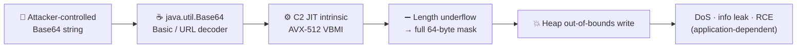

The incident illustrates three broader challenges:

1. **Performance optimizations can introduce memory-safety bugs** beneath otherwise memory-safe application code.
2. **Shared runtimes create wide exposure** across unrelated applications. Calif demonstrated pre-authentication exploitation in Keycloak, Jira, Confluence, Artifactory, Jenkins, and PingFederate.
3. **AI-assisted vulnerability research is getting fast.** Calif reports that a researcher directing OpenAI Codex found the bug in about an hour, for under $200 in tokens.

**Immediate priorities for enterprise teams:** find the Java runtimes actually in use, especially bundled ones; check the CPU condition; patch Internet-facing and identity systems first; apply the interim JVM flag where you can't patch yet; and hunt for crashes and post-exploitation behavior.

---

## 1. Understanding Java4Shell

Much of Java's reputation for memory safety comes from the JVM: managed allocation, garbage collection, bounds checks, and bytecode verification. But the JVM itself is written in C++ and hand-tuned assembly. **Those native layers don't inherit the safety guarantees they provide to Java code.** Java4Shell is a clear example.

### 1.1 Vulnerability overview

| Attribute | Description |
|---|---|
| **CVE** | CVE-2026-114938 (OpenJDK bug JDK-8393212) |
| **Common name** | Java4Shell |
| **Discovered by** | Quang Luong (Calif), with AI assistance; Oracle also credits Albert Yang |
| **Affected component** | HotSpot `StubGenerator::generate_base64_decodeBlock()`, the AVX-512 Base64 decode intrinsic used by `java.util.Base64.Decoder` |
| **Weakness** | CWE-191 Integer Underflow → CWE-787 Out-of-Bounds Write (heap) |
| **Platform condition** | x86-64 CPUs with **AVX-512 VBMI** (and BW). **ARM64 is not affected.** |
| **Severity** | Oracle: **8.1** CVSS 3.1 (attack complexity high) · Calif: **9.2** CVSS 4.0 |
| **Potential impact** | Denial of service (most readily achievable), information disclosure, remote code execution |
| **Authentication** | None required, *if* the application decodes attacker-supplied Base64 before login |
| **Public disclosure** | November 17, 2026 |
| **Exploitation status** | GreyNoise saw exploitation **attempts** from Nov 18; no confirmed successful exploitation reported; not in CISA KEV at time of writing |
| **Remediation** | Fixed vendor JVM builds (Nov 17 onward); interim JVM flag where patching is delayed |

### 1.2 Java4Shell vs Log4Shell

| | **Log4Shell (2021)** | **Java4Shell (2026)** |
|---|---|---|
| Where the bug lives | Log4j library (application dependency) | HotSpot JVM (runtime) |
| Bug class | Unsafe JNDI lookup (logic / injection) | Integer underflow → heap memory corruption |
| Hardware dependent? | No | **Yes**: x86-64 with AVX-512 VBMI only |
| Generic exploit? | Yes, largely universal | **No**: exploits must be tailored per application |
| Fix | Upgrade Log4j | **Upgrade the JVM**, including bundled and container runtimes |

> 💡 Replacing an application dependency doesn't fix this. **The runtime underneath has to change.**

---

## 2. Technical Root Cause: Base64 Decoding and the JIT Compiler

### 2.1 Why Base64 is everywhere in the attack surface

Base64 is an **encoding**, not encryption. Enterprise applications routinely decode attacker-reachable Base64 in:

- HTTP `Authorization: Basic` headers (Tomcat Basic authentication, for example)
- JSON Web Token segments (JWT libraries such as `java-jwt`)
- SAML messages and other identity-protocol artifacts
- API payloads, file uploads, and serialized data
- Session and cookie values

In the tested builds, the vulnerable fast path serves **`Base64.getDecoder()`** (basic) and **`Base64.getUrlDecoder()`** (URL-safe). **`Base64.getMimeDecoder()` bypasses it**, as do Base64 libraries that don't call `java.util.Base64`.

### 2.2 How HotSpot JIT turns hot code into intrinsics

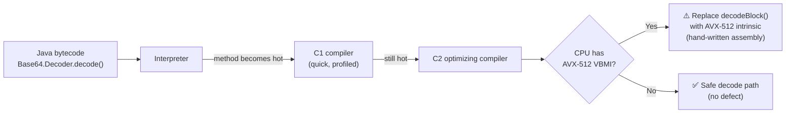

HotSpot starts by interpreting bytecode. When a method runs often, the **C2** compiler can substitute an **intrinsic**: a hand-optimized machine-code routine that uses processor-specific instructions. That's why the bug only fires on busy code paths that C2 has compiled, and only on CPUs with the right instruction set.

### 2.3 AVX-512 and masked vector stores

AVX-512 instructions operate on 64-byte vectors. A **masked store** (`VMOVDQU8` with a 64-bit mask register) writes only the bytes whose mask bit is set. The safety of the whole routine depends on one thing: **the mask must exactly match the number of valid output bytes.** Java4Shell breaks that.

---

## 3. From Integer Underflow to Memory Corruption

### 3.1 The arithmetic

The intrinsic decodes 64 input characters into 48 output bytes per block. A separate tail handler processes the final fragment shorter than 64 characters. For a fragment under 4 characters, the output size is computed as `(len / 4) × 3`, which is **0**. Padding then decrements the count **with no check for a negative result**.

```text
Tail fragment length:        1   ("=")
Output size (1/4)*3:         0
Padding adjustment:         -1
Result:                     -1

As 64-bit two's complement:  0xFFFFFFFFFFFFFFFF
BZHI(all-ones, -1)        →  all 64 mask bits still set
```

### 3.2 From mask to memory corruption

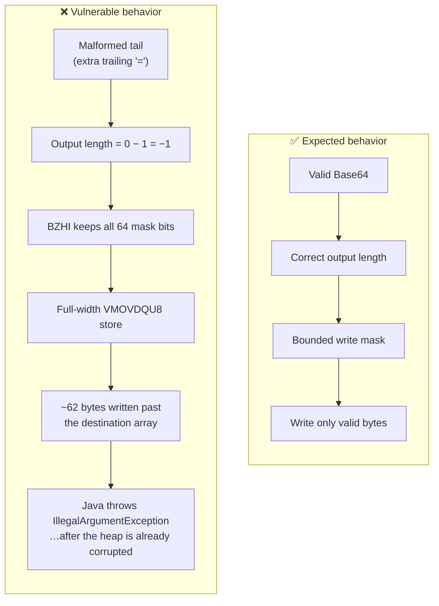

### 3.3 What actually lands in memory

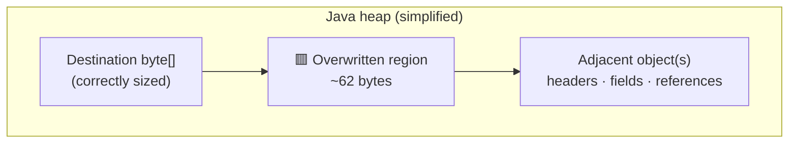

Published analyses add important detail:

- A minimal trigger is just **65 characters**: 64 valid characters plus `=`. Calif's own PoC triggers the bug without taking control of the system.
- The excess bytes are **not arbitrary**. The tail handler pads unused lanes, so the overflow is mostly a repeating pattern. This is a constrained overwrite, which makes reliable exploitation harder.
- In Upwind's lab on an Ice Lake AWS instance, the overflow corrupted the adjacent object in **97%** of rounds and eventually **crashed** the JVM.
- **Catching the exception doesn't help.** The write happens before the exception is thrown.

> ⚠️ This mismatch between application-level error handling (input rejected, exception caught) and runtime memory safety (heap already corrupted) is what makes Java4Shell dangerous.

---

## 4. How Memory Corruption Can Lead to Remote Code Execution

An out-of-bounds write doesn't automatically mean code execution. Impact depends on heap layout, neighboring objects, garbage-collector behavior, application request handling, and the attacker's ability to shape memory.

### 4.1 Possible outcomes, roughly from most to least likely

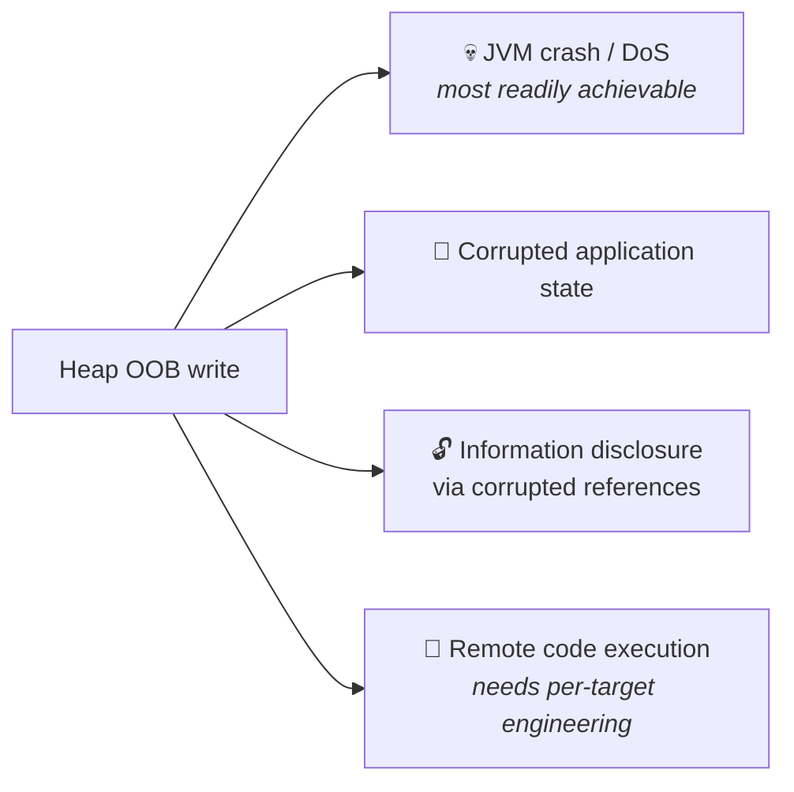

### 4.2 Why exploitation needs engineering

Turning the primitive into reliable RCE means **heap grooming**: arranging allocations so the constrained overwrite hits a useful object, then chaining that into control of execution. That depends on the specific application, framework, JDK build, and GC. Calif and independent researchers have said there is **no universal exploit**:

- Calif demonstrated chains in default configurations: **pre-auth** in Keycloak, Atlassian Jira and Confluence, JFrog Artifactory, Jenkins, and PingFederate; **post-auth** in Apache Kafka, Solr, Elasticsearch, Gerrit, and Spinnaker. The list is not exhaustive.
- Researchers at Immersive and VulnCheck report working exploits that need adapting per application.
- Researcher samczsun reportedly showed that **Java clients** can be compromised by connecting to a malicious server. Don't think only about inbound services.

### 4.3 Why authentication systems are especially sensitive

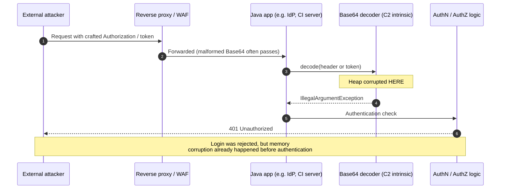

Many authentication flows **decode before they authenticate**, so the vulnerable path sits in front of the login check. That's why identity providers, SSO gateways, and CI/CD servers exposed to untrusted networks are the top patching priority.

---

## 5. Exposure Assessment: Which Systems Are at Risk?

Exposure requires **all** of the following at once:

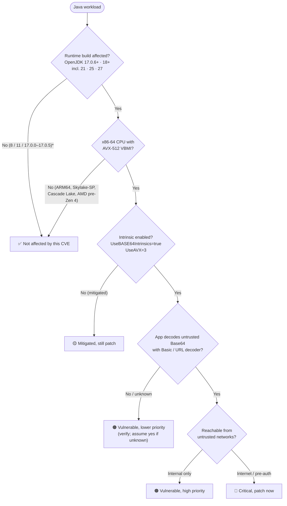

<sub>*Oracle's Java 8 **Enterprise Performance Pack** (8u511b33-perf) is affected. Specialized or vendor-modified distributions need separate verification.</sub>

| Condition | What to check |
|---|---|
| **Java runtime** | The exact vendor build used by each *running process*, including runtimes bundled inside products and container images |
| **CPU** | x86-64 host reports `avx512vbmi` (plus `avx512f`, `avx512bw`, `bmi2`). Cloud instance families differ: check the actual host. |
| **JVM flags** | `UseBASE64Intrinsics` and `UseAVX` values on the running process |
| **Application behavior** | Does reachable code pass untrusted input to `Base64.getDecoder()` / `getUrlDecoder()`? |
| **Reachability** | Internet-facing and pre-authentication paths first |
| **Patch status** | Vendor fixed build or documented backport, not just the version string |

### 5.1 Host assessment (Linux, read-only)

**1. Does the CPU expose AVX-512 VBMI?**

```bash
grep -om1 -E 'avx512[_]?vbmi' /proc/cpuinfo || echo "No AVX-512 VBMI: not exposed via this path"
```

**2. Which JVMs are actually running?** Use the process, not the `java` on your `PATH`:

```bash
# List running JVMs and the java binary each one uses
for pid in $(pgrep -x java); do
  echo "PID $pid -> $(readlink -f /proc/$pid/exe)"
done

# Version and effective flags of a specific running JVM (run as the process owner)
jcmd <PID> VM.version
jcmd <PID> VM.flags -all | grep -E 'UseBASE64Intrinsics|UseAVX'
```

**3. Container images:** inspect the runtime inside the image (for example `docker run --rm --entrypoint java <image> -version`) and rebuild from a fixed base image.

> These checks give you inventory, not proof of exploitability or remediation. Also be aware that some vulnerability scanners match on Java version only and ignore the CPU condition, so expect over-reporting.

---

## 6. Enterprise Mitigation and Patch Management

### 6.1 Apply vendor-fixed runtimes

Reported fixed versions (verify against your vendor's own advisory):

| Line | Affected | Fixed (OpenJDK / Oracle) |
|---|---|---|
| Java 17 | 17.0.6 through 17.0.21 | **17.0.21.1** |
| Java 21 | Before 21.0.13.1 | **21.0.13.1** |
| Java 25 | Before 25.0.5.1 | **25.0.5.1** |
| Java 27 | Before 27.0.1.1 | **27.0.1.1** |
| Oracle Java 8 Perf Pack | 8u511b33-perf | **8u513-perf** |
| GraalVM for JDK 17 / 21 | 17.0.21.0.3 / 21.0.13.0.3 | 17.0.21.1 / 21.0.13.1 |

**Vendor status snapshot (as reported Nov 18–19):** Oracle, Amazon Corretto, Azul Zulu, Microsoft Build of OpenJDK, and Ubuntu (openjdk-17/21/25/27) had fixed builds; Eclipse Temurin had begun releasing them; Red Hat shipped fixed RHEL OpenJDK packages, with some bundled products such as Red Hat build of Keycloak still listed as affected at the time; Debian 13 had fixed openjdk-21 and 25, with openjdk-17 in Debian 12 still pending. Vendor status changes quickly, so re-check before closing.

> 📋 **Change-board note:** the November OpenJDK update is an out-of-band release that also carries **eight other CVEs** (CVE-2026-114939 through 114946 on RHEL). It's not a Java4Shell-only change.

**Patch priority**

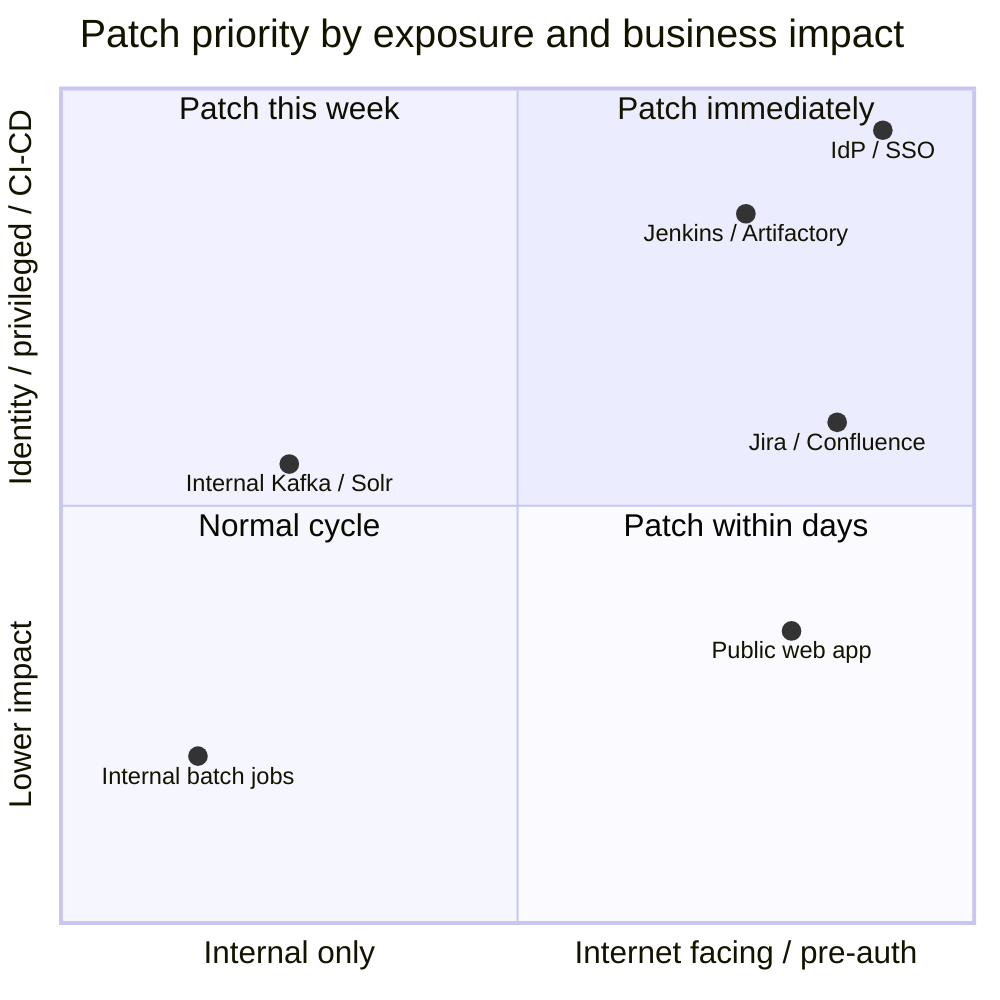

1. Internet-facing Java applications and **authentication platforms** (IdP, SSO, federation)
2. Identity providers and privileged management services
3. CI/CD and artifact infrastructure (Jenkins, Artifactory, Gerrit)
4. Internal business-critical Java applications
5. Runtimes **embedded in third-party products and appliances** (ask the vendor)

For containers: update base images → rebuild → redeploy → confirm the running pods use the new runtime.

### 6.2 Interim JVM mitigation (when you can't patch yet)

Calif, Datadog, and Keycloak document two startup options. **Neither appears in the Oracle or OpenJDK advisories**, so test them before relying on them.

| Option | Effect | Trade-off |
|---|---|---|
| `-XX:-UseBASE64Intrinsics` | Disables **only** the Base64 intrinsic | **Preferred.** Narrow, with minimal performance impact outside Base64-heavy workloads |
| `-XX:UseAVX=2` | Disables AVX-512 use entirely | Broader performance impact. **x86-64 only: ARM64 JVMs may fail to start with it**, so don't push it fleet-wide blindly |

```bash
# Example: add via JAVA_TOOL_OPTIONS or the product's JVM options file, then restart
export JAVA_TOOL_OPTIONS="-XX:-UseBASE64Intrinsics"

# Verify on the running process
jcmd <PID> VM.flags -all | grep UseBASE64Intrinsics   # expect: false
```

Flags take effect only after a **restart**, and they're a stopgap, not a substitute for patching.

### 6.3 Defense in depth

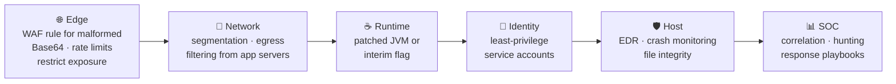

- Restrict unnecessary external access to Java services.
- **Egress-filter** application servers so a compromised JVM can't freely call out.
- Run services as least-privileged identities; segment them from unrelated internal systems.
- Monitor JVM crashes and suspicious process behavior (§7).
- Keep an accurate runtime inventory, including standby and DR environments.

> **WAF note:** a Base64 value whose length leaves a remainder of 1 when divided by 4 is never valid, so rejecting such values in headers and tokens at the edge is low-risk. It reduces exposure, but WAF rules can't cover every encoded field. They don't fix the defect.

---

## 7. SOC Detection and Incident Response

A failed attempt will often **crash** the JVM. A successful exploit may leave **no application error at all** and stay entirely inside the Java process. Detection has to combine application, host, network, and identity telemetry.

### 7.1 Recommended telemetry

| Data source | Investigation focus |
|---|---|
| Java application logs | Spikes in `IllegalArgumentException` from Base64 decoding; unusual auth-header or token errors |
| JVM / OS | **`hs_err_pid*.log`** fatal-error files, core dumps, unexpected restarts (systemd, Kubernetes `CrashLoopBackOff`) |
| EDR / XDR | Java spawning shells or utilities; new files in web or app directories; credential access |
| Reverse proxy / WAF | Malformed Base64 in `Authorization`, JWT, SAML, or cookie fields; bursts from single sources |
| Network | New outbound connections from Java servers; connections to rare destinations |
| Identity | Suspicious access or privilege changes involving service accounts used by the app |
| Threat intel | Scanner and exploit-attempt IPs (e.g., GreyNoise tags for this CVE) |

### 7.2 Threat-hunting workflow

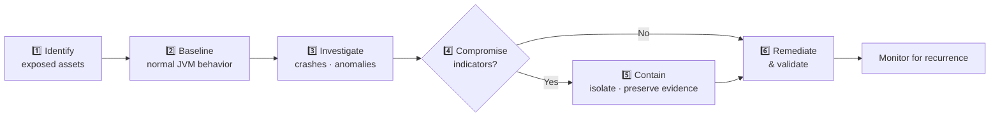

1. **Identify exposed assets:** vulnerable runtime + VBMI CPU + reachable Base64 path, prioritizing untrusted networks.
2. **Establish a baseline:** normal child processes, errors, outbound connections, admin activity.
3. **Investigate anomalies:** correlate JVM crashes, malformed-input spikes, unusual processes, and new network flows.
4. **Determine compromise indicators:** unexpected files, child processes, credential access, persistence, lateral movement.
5. **Contain confirmed compromise:** isolate through EDR or network controls, preserve memory and disk evidence, involve app owners.
6. **Remediate and validate:** fixed runtime, rebuild compromised hosts, verify functionality, keep monitoring.

> An exposed runtime is **vulnerable**, not automatically **compromised**.

### 7.3 Microsoft Defender XDR / Sentinel hunting queries

All of these are **behavioral or inventory hunts, not Java4Shell exploit signatures**. Tune them to your environment. In Sentinel with Defender XDR tables streamed, use `TimeGenerated` instead of `Timestamp`.

#### KQL 1: Vulnerable devices from Defender Vulnerability Management

```kql
DeviceTvmSoftwareVulnerabilities
| where CveId == "CVE-2026-114938"
| summarize Software = make_set(strcat(SoftwareVendor, " ", SoftwareName, " ", SoftwareVersion), 10)
            by DeviceId, DeviceName, OSPlatform
| join kind=leftouter (
    DeviceInfo
    | summarize arg_max(Timestamp, IsInternetFacing, PublicIP) by DeviceId
  ) on DeviceId
| project DeviceName, OSPlatform, IsInternetFacing, PublicIP, Software
| order by IsInternetFacing desc
```

Version-based results don't account for the CPU condition. Treat this as a candidate list, then check VBMI per host.

#### KQL 2: JVM fatal-error logs (possible failed exploitation or crash)

```kql
DeviceFileEvents
| where Timestamp > ago(7d)
| where ActionType == "FileCreated"
| where FileName startswith "hs_err_pid" and FileName endswith ".log"
| summarize Crashes = count(), FirstSeen = min(Timestamp), LastSeen = max(Timestamp),
            Paths = make_set(FolderPath, 5)
            by DeviceName, InitiatingProcessFileName
| order by Crashes desc
```

A sudden crash cluster on an exposed, vulnerable host deserves investigation: pull the `hs_err` file and look for crashes in compiled Base64 or GC code. Crashes alone are not proof of exploitation.

#### KQL 3: Java processes spawning shells or download utilities

```kql
DeviceProcessEvents
| where Timestamp > ago(7d)
| where InitiatingProcessFileName in~ ("java", "java.exe", "javaw.exe")
| where FileName in~ ("cmd.exe", "powershell.exe", "pwsh.exe", "bash", "sh", "dash",
                      "zsh", "curl", "wget", "python", "python3", "perl", "nc", "ncat",
                      "whoami", "id", "uname")
| project Timestamp, DeviceName, AccountName, InitiatingProcessCommandLine,
          FileName, ProcessCommandLine, InitiatingProcessParentFileName
| order by Timestamp desc
```

Build servers and some app servers launch scripts legitimately. Baseline per application, and pay attention to recon commands (`whoami`, `id`, `uname`) on servers that never run them.

#### KQL 4: Rare outbound connections from Java processes

```kql
let Lookback = 14d;
let Recent = 1d;
let Known = DeviceNetworkEvents
    | where Timestamp between (ago(Lookback) .. ago(Recent))
    | where InitiatingProcessFileName in~ ("java", "java.exe", "javaw.exe")
    | where RemoteIPType == "Public"
    | distinct DeviceId, RemoteIP;
DeviceNetworkEvents
| where Timestamp > ago(Recent)
| where InitiatingProcessFileName in~ ("java", "java.exe", "javaw.exe")
| where RemoteIPType == "Public"
| join kind=leftanti Known on DeviceId, RemoteIP
| summarize Connections = count(), Ports = make_set(RemotePort, 10),
            Urls = make_set(RemoteUrl, 10), FirstSeen = min(Timestamp)
            by DeviceName, RemoteIP
| order by FirstSeen desc
```

Some exploitation stays entirely in memory and never spawns a process or touches disk. Network egress and application-level anomalies may be the only signals, which is another reason egress filtering matters.

---

## 8. AI-Assisted Vulnerability Discovery

Java4Shell is one of the clearest public examples yet of AI-accelerated vulnerability research.

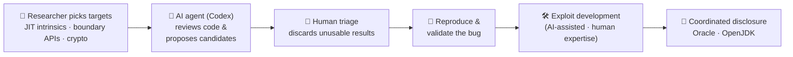

Per Calif's account:

- Researcher **Quang Luong** directed **OpenAI Codex** at the JIT compiler, intrinsics, widely reachable APIs, and cryptography.
- The Base64 finding surfaced after many unusable results. Discovery took **about one hour**, the first working exploit about **two more hours**, and total token cost was **under $200**.
- The human chose the targets and supplied the exploitation expertise. Calif built tooling (including a heap tracer and visualizer) so AI agents could help develop later exploit chains.
- It was Calif's second major AI-assisted finding in weeks, after "PHP2Shell" in October.

**What this means:** an AI observation isn't proof of a vulnerability. Human triage, reproduction, and responsible disclosure still decided the outcome. But the **cost and time** to find deep, low-level bugs have dropped sharply, and that applies to attackers as well as defenders.

### 8.1 Implications for defenders

| Defenders can use AI for… | …while assuming attackers will too |
|---|---|
| Code review and patch-diff analysis | Faster discovery of bugs in shared runtimes and libraries |
| Advisory triage and exposure mapping | Faster patch-to-exploit turnaround |
| Detection engineering and query drafting | More tailored, per-application exploit chains |
| Incident evidence correlation | Larger volume of CVEs to triage |

The deciding factor increasingly isn't *whether* a bug is found, but **how fast you can find your exposure, validate controls, and remediate**.

---

## 9. Lessons for Security Architecture

| # | Lesson | Practical takeaway |
|---|---|---|
| 9.1 | **Memory-safe languages still sit on native code** | Include JVMs, JIT compilers, and native libraries in vulnerability management and SBOMs |
| 9.2 | **Hardware acceleration expands the review surface** | Behavior can differ by CPU model; record CPU features in asset inventory and test across them |
| 9.3 | **Input validation helps but doesn't replace runtime patching** | Reject malformed input early, but treat vendor fixes as the real remediation |
| 9.4 | **Segmentation limits blast radius** | Zero Trust, egress control, and workload identity contain a compromised JVM |
| 9.5 | **IR must go beyond scanner output** | Scanners see versions; you also need CPU, flags, reachability, and compromise evidence |
| 9.6 | **Optimizations ship to everyone** | Calif argues for removing performance features few applications need, which it calls "vibe-uncoding" |

**The questions a scanner can't answer for you:**

- Which JVM is each application *actually* running, including bundled runtimes?
- Does the host CPU expose AVX-512 VBMI?
- Is the vulnerable decoder reachable with untrusted input, before authentication?
- Is the runtime patched or mitigated, and have the processes been restarted?
- Are there signs of compromise?
- If compromised, what else could this server reach?

---

## 10. Conclusion

Java4Shell (CVE-2026-114938) shows that **a performance optimization deep inside a trusted runtime can become a critical attack surface.** One missing bounds check in a few lines of hand-written assembly turned a routine Base64 decode into a heap overwrite. In default configurations of widely used enterprise software, that overwrite was reachable before login.

Effective protection depends on accurate runtime inventories, hardware-aware exposure assessment, fast patching, endpoint and network monitoring, and tested incident response. AI-assisted research is compressing the time between "bug exists" and "exploit exists," which makes all of those faster cycles more important.

> **Security depends not only on the code we write, but also on the runtime, compiler, hardware, and infrastructure that execute it.**

---

## References

- Calif, *Java4Shell* disclosure and technical write-up: https://calif.io/java4shell/
- Datadog Security Labs, *Java4Shell: Remote Code Execution in OpenJDK (CVE-2026-114938)*: https://securitylabs.datadoghq.com/articles/java4shell-remote-code-execution-in-openjdk-cve-2026-114938/
- Tenable, *Java4Shell FAQ*: https://www.tenable.com/blog/java4shell-cve-2026-114938-frequently-asked-questions-about-openjdk-rce-vulnerability
- Sophos, *Advisory: OpenJDK Base64 Vulnerability – Java4Shell*: https://www.sophos.com/en-us/security-advisories/sophos-sa-20261118-java4shell
- VulnCheck, *Java4Shell CVE-2026-114938*: https://www.vulncheck.com/blog/java4shell
- Endor Labs, *Java4Shell: Pre-Auth Heap Overflow in OpenJDK*: https://www.endorlabs.com/learn/java4shell-unauthenticated-rce-reported-in-openjdk-17-cve-2026-114938
- Red Hat errata (example), RHSA-2026:100573: https://access.redhat.com/errata/RHSA-2026:100573
- The Hacker News, *Java4Shell Enables Pre-Auth RCE in Jira, Jenkins, Keycloak and More*: https://thehackernews.com/2026/11/java4shell-cve-2026-114938-enables-pre.html
- Canadian Centre for Cyber Security, Alert AL26-029, and CISA alert (Nov 17, 2026): see each agency's advisories page

---

<sub>This article is for defensive security education, vulnerability management, and authorized research. It deliberately omits exploit code. Detection queries and commands are illustrative and must be validated in your own environment. Vendor patch status was current as of November 2026 and changes quickly.</sub>
